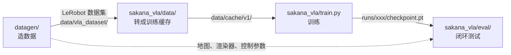

# 代码导读（`vla` 分支，第一版纯 VLA）

这份文档帮你读懂这个仓库里的全部代码。一共 28 个 Python 文件，大约 2900 行。
每一节先说"这段代码在做什么"，再说"关键函数"，最后说"读的时候容易看错的地方"。

---

## 0. 先看全局

整个项目只做一件事：**让一架室内无人机听一句话，看着自己的相机画面，飞到目标物体前面停下**。

代码分成三段，前一段的输出是后一段的输入：



| 文件夹 | 做什么 | 行数 | 用哪个 conda 环境 |
|---|---|---|---|
| `datagen/` | 在仿真里让"专家"飞，录下画面和动作，写成数据集 | 约 1600 | `sakana_hyperdrone` |
| `vla_data/` | 一个最小的数据集读取器，给外部使用者看格式用 | 100 | 任意 |
| `sakana_vla/data/` | 把数据集解码成一个大数组，生成训练样本 | 200 | `sakana_vla2` |
| `sakana_vla/model/` | 模型本体：Qwen3.5 视觉语言模型 + 动作专家 | 235 | `sakana_vla2` |
| `sakana_vla/train.py` | 训练循环和离线指标 | 184 | `sakana_vla2` |
| `sakana_vla/eval/` | 闭环测试：模型真的在仿真里飞 | 560 | 两个环境都用 |
| `scripts/` | 两个启动数据生成的 shell 脚本 | 12 | — |

**为什么有两个环境。** 仿真器（HyperDrone、hyperlux）和模型（torch、transformers）的依赖装不到一起。
所以闭环测试时开两个进程：仿真进程和模型进程，通过本机的 Unix socket 传数据。

### 建议的阅读顺序

1. `sakana_vla/data/dataset.py`：先搞清楚一条训练样本长什么样。
2. `sakana_vla/model/vla.py`：模型怎么算 loss、怎么出动作。只有 89 行。
3. `sakana_vla/model/expert.py`：动作专家的内部结构。
4. `sakana_vla/train.py`：训练循环。
5. `sakana_vla/eval/policy_server.py` 和 `closed_loop.py`：模型怎么被用起来。
6. `datagen/`：数据是怎么来的。按 `generate.py` 的调用顺序读。

---

## 1. 必须先知道的几个约定

这些约定贯穿所有文件。不知道它们，后面的代码会看不懂。

**两个频率。** 物理仿真是 100 Hz（一步 0.01 秒）。数据记录和模型看到的画面是 10 Hz（一帧 0.1 秒）。
代码里说"frame"是 10 Hz 的帧，说"step"通常是 100 Hz 的物理步。

**坐标系。** 世界坐标 Z 轴朝上，单位是米。四元数顺序是 `(w, x, y, z)`。
"yaw 坐标系"指只按机头朝向旋转的坐标系：x 是机头前方，y 是左边，z 是上。它不管机身的俯仰和横滚。

**一个动作是 5 个数。** `[dx, dy, dz, dyaw, stop]`。
前三个是 0.1 秒内的位移，写在 yaw 坐标系里。`dyaw` 是 0.1 秒内机头转了多少弧度。`stop` 是 0 或 1，表示"任务完成，该停了"。

**动作块（chunk）。** 模型一次不是出 1 个动作，而是出未来 12 帧的动作，也就是 1.2 秒。形状是 `(12, 5)`。
这 12 个动作全部写在**当前这一帧**的 yaw 坐标系里，不是每一帧各用各的。
执行时只用前 5 帧（0.5 秒），然后重新看画面、重新出一块。

**状态是 5 个数。** `[vx, vy, vz, 偏航角速度, 高度]`，速度写在 yaw 坐标系里。模型看不到自己的绝对位置。

**停止帧不带运动。** 只要 `stop = 1`，这一帧的前 4 个数就被清成 0。

---

## 2. `datagen/`：造数据

入口是 `generate.py`。它对每个房子按下面的顺序调用其他文件：

```
scene_parse（提前跑一次）→ geometry → tasks → planner → expert_rollout → label → render → write_dataset
```

### 2.1 `scene_parse.py`：读房子

输入是 ProcTHOR 的一个 GLB 三维模型文件。输出是 `data/scenes/<房子名>.json`。

- `parse()`：遍历 GLB 里的顶层节点。名字以 `Floor#room|` 开头的是房间，带 `segmentation_class` 的是物体。每个物体算出世界坐标下的包围盒（AABB）。
- **房间类型是猜的。** GLB 里没有房间类型，所以看房间里有什么：有马桶是浴室，有冰箱是厨房，见 `ROOM_CUES`。
- **哪些物体能当目标。** `target_ok` 要同时满足：这个类别在全屋只有一个、不是墙和门窗之类、够大（中间那条边至少 0.3 米，最长边至少 0.4 米）。类别唯一是为了让语义分割图直接当作这个物体的掩码。
- `build_labels()`：统计很多房子，给每个类别编号选一个可读的英文名，写到 `class_labels.json`。
- `GLTF_TO_WORLD`：GLB 是 Y 轴朝上，这里转成 Z 轴朝上。

### 2.2 `geometry.py`：把房子变成格子地图

`build_maps(glb)` 返回一个字典，后面所有模块都用它：

| 键 | 含义 |
|---|---|
| `grid` | `Grid` 对象，负责世界坐标和格子下标互转。格子边长 0.1 米 |
| `occ` | 三维布尔数组，这个格子里有没有表面 |
| `clearance` | 每个格子到最近障碍物的距离，单位米。用欧氏距离变换算的 |
| `inside` | 二维数组，这一列是不是在房子里（地板上方） |
| `floor_z` | 地板高度 |

`flight_mask(maps)` 给出"无人机允许待的格子"：在房子里、离地 0.5 到 2.0 米、离障碍至少 0.3 米。只保留最大的连通块。

**`clearance` 是全项目最重要的数组。** 规划用它躲障碍，专家和闭环测试都用它判碰撞（小于 0.12 米算撞）。

### 2.3 `tasks.py`：出题

一道题是"从哪出发、飞到哪、看什么物体"。`sample_episodes()` 是一个生成器，每次给出 `(spec, field)`：

1. 随机选一个可当目标的物体。
2. `sample_goal_viewpoint()`：在物体旁边 0.6 到 1.4 米处找一个悬停点，要求在可飞区域内、物体在视野里、中间没有遮挡（`line_of_sight`）。这个点叫 **goal**。
3. 以 goal 为终点建一个 `GoalField`（见下一节）。
4. `sample_starts()`：挑若干个起点，离 goal 的最短路距离在 3 到 12 米之间，机头朝向随机。

`spec` 是一个字典，含 `house`、`target`、`goal`、`start`、`geodesic`。它一路传到最后写进数据集。

### 2.4 `planner.py`：规划参考轨迹

- **`GoalField`**：在可飞格子上从 goal 出发跑一次 Dijkstra。结果是每个格子到 goal 的最短距离 `dist` 和下一步往哪走 `pred`。一次计算能服务这个目标的所有起点，以及中途重新规划。边的代价会对贴墙的格子加惩罚，所以路径会走在通道中间。
- `smooth_path()`：格子路径是折线。先 `shortcut` 拉直能直连的段，再拟合三次样条。如果样条蹭到障碍，就加密重试。
- `speed_profile()`：梯形速度曲线。最大速度 0.5 m/s，加速度 0.5 m/s²，到终点减速到 0。
- `yaw_profile()`：机头跟着飞行方向。最后 1 米逐渐转向目标物体。转速有上限。
- **`reference_trajectory()`**：把上面拼起来，输出 100 Hz 的参考轨迹 `(N, 4) = [x, y, z, yaw]` 和每一步的阶段标签。阶段依次是 `rotate`（起步方向差 60° 以上时先原地转）、`fly`、`rotate`（到点后对准目标）、`hover`（悬停 1 秒）。

### 2.5 `expert_rollout.py`：专家真的去飞

参考轨迹只是几何曲线。这个文件让带动力学的无人机去跟踪它，并记录**真实飞出来的状态**。

- `rollout()`：一批无人机同时仿真，每架飞一道题。每个物理步把参考轨迹上的点作为位置指令发给底层控制器（RAPTOR）。
- **两个补偿。** `LEAD_STEPS = 55`：指令取参考轨迹上 0.55 秒之后的点，因为控制器有滞后。`Z_SAG_COMP = 0.053`：高度指令加 5.3 厘米，因为无人机悬停时会低一点。
- **扰动。** 一半的题目会在飞行中途被踢一脚：侧向速度突然加 0.5 到 1 m/s，机头偏 15° 到 45°。专家先愣 0.4 秒（继续用旧指令），然后从当前状态重新规划。这样数据里有"偏离后纠正"的片段，模型能学到怎么救回来。
- **失败判定。** 撞了（`collision`）、离参考轨迹超过 0.6 米（`tracking`）、超时、规划失败。失败的题目会被丢掉。
- 每 10 个物理步记录一次，存进 `Episode.records`。

批里没用上的无人机被放到 50 米高空，不参与任何计算。这个小技巧在闭环测试里也有。

### 2.6 `label.py`：打标签

输入是真实飞出来的 10 Hz 轨迹。

- `actions_from_states()`：相邻两帧的位置差，旋转到当前帧的 yaw 坐标系，得到每帧的 `[dx, dy, dz, dyaw, stop]`。
- **`stop_flags()`**：一帧算"停止"要同时满足三条：离 goal 小于 0.15 米、机头对准目标误差小于 10°、处于 `hover` 阶段。而且只取**结尾连续的那一段**，中途偶然满足的不算。
- `primitives()`：看未来 1 秒的运动，给每帧贴一个动作名，一共 13 种，比如 `move forward`、`turn left`、`hover`、`stop`。
- `instruction_draft()`：用模板拼一句英文指令，例如"Leave the bedroom, go to the kitchen, and stop in front of the fridge."

### 2.7 `render.py`：渲染画面

- `Renderer.render(positions, quats)`：输入一批位姿，输出 RGB、深度、语义分割，分辨率都是 256×256。
- `camera_pose()`：相机固定在机身上，朝前，视场角 90°。因为用的是真实姿态，画面里能看到飞行时的俯仰和横滚晃动。
- `target_bbox()`：在语义分割图里找目标类别的像素，返回归一化的边界框和像素数。像素数后面用来判断"目标是否可见"。

### 2.8 `write_dataset.py`、`merge_subsets.py`、`generate.py`

- `DatasetWriter.add()`：把一条轨迹写成 LeRobot v2.1 格式。每条轨迹一个 parquet 表（每帧一行）、一个 AV1 视频、一个深度 npz、几张关键帧图片。
- `generate.py` 的 `main()`：把上面所有步骤串起来，并做质量检查。下面这些情况会丢掉这条轨迹：专家失败、长度不在 20 到 600 帧之间、停止帧少于 3 帧、最后一帧目标像素少于 150、画面全黑或深度异常。
- `merge_subsets.py`：数据是每个房子一个任务并行生成的。这个脚本把多份合并成一份，并把轨迹编号重新排成连续的。
- `spike.py`：只跑一个房子的调试脚本，会画俯视图和叠加了标签的视频。排查问题时用。
- `_jitfix.py`：一个补丁。新节点上 hyperlux 的编译步骤会卡死，这里把它的输出改成直接打印就不卡了。**必须在 `import hyperlux` 之前导入它**。

### 数据集里最重要的几列

| 列名 | 内容 |
|---|---|
| `observation.states` | `[x, y, z, yaw]`，相对于这条轨迹的起点，写在起点的 yaw 坐标系里 |
| `observation.state_full` | 13 个数：世界位置 3、四元数 4、世界速度 3、角速度 3 |
| `actions` | 每帧的 `[dx, dy, dz, dyaw, stop]` |
| `caption` | 指令文本 |
| `env` | 房子名 |

`meta/episodes_extra.jsonl` 里每条轨迹还有一行额外信息：起点、goal、目标物体的包围盒、最短路长度。**闭环测试靠它来复现题目。**

---

## 3. `vla_data/indoor_dataset.py`：最小读取器

`IndoorVLADataset(root, horizon=10)` 直接读 LeRobot 数据集，返回 RGB、深度、指令、状态、动作块。
它是给数据集使用者的示例，**训练不用它**。

> **容易看错：仓库里有两种动作块定义。**
> 这个文件的块是**累积路点**（第 k 个数是"k 帧后相对现在的位置"），默认 10 帧。
> 训练用的 `sakana_vla/data/dataset.py` 的块是**逐帧增量**（第 k 个数是"第 k 帧这 0.1 秒内的位移"），默认 12 帧。
> 两者的关系是：增量做累加就是路点。

---

## 4. `sakana_vla/data/`：训练数据

### 4.1 `frames_cache.py`：一次性解码

训练时随机读视频帧很慢。`build()` 把所有视频解码一遍，写成三个文件：

| 文件 | 内容 |
|---|---|
| `frames.npy` | 所有帧拼成一个大数组 `(N, 256, 256, 3)`，uint8。训练时用内存映射随机访问 |
| `meta.npz` | 每帧的 `states`、`state_full`、`stop`、所属轨迹 `ep`、帧号 `t` |
| `episodes.json` | 每条轨迹的来源子集、起始偏移 `offset`、长度、房子、指令 |

现在的缓存 `data/cache/v1` 有 1723 条轨迹，约 26 万帧。

文件开头的注释写的文件名是旧的（`frames.u8`、`meta.json`），以代码为准。

### 4.2 `dataset.py`：一条训练样本

这个文件最值得细读。

**`chunk_increments(cache, i, horizon)`** 算第 `i` 帧的训练目标，形状 `(12, 5)`：

1. 取第 t 到 t+12 帧的 `[x, y, z, yaw]`。超出轨迹末尾的帧用最后一帧顶替。
2. 相邻帧的位置差，全部旋转到**第 t 帧**的 yaw 坐标系。
3. 相邻帧的 yaw 差，绕回到 −π 到 π。
4. `stop` 取第 t+1 到 t+12 帧的停止标记。超出轨迹末尾的位置填 1。
5. `stop = 1` 的那些帧，前 4 个数清零。

**`state_vector(cache, i)`** 从 `state_full` 算出 5 维状态：速度转到 yaw 坐标系，加上偏航角速度和高度。

**归一化。**
- `compute_norm_stats()`：抽 2 万帧，对运动中的帧统计每个动作维度的 0.5% 和 99.5% 分位数，取绝对值较大的那个作为上界 `action_bound`。
- `normalize_actions()`：前 4 维除以上界并裁到 [−1, 1]。`stop` 从 {0, 1} 变成 {−1, +1}。
- `denormalize_actions()` 是反过来。`stop` 变回 0 到 1 之间的数，大于 0.5 就算停。
- 状态用均值和标准差归一化。

**`VLADataset.__getitem__`** 返回一个字典：`image`、`instruction`、`state`、`actions`（归一化后）、`raw_actions`（没归一化，算指标用）、`index`。

**`Collator`** 把一批样本变成模型输入。它把图片和下面这句提示词套进 Qwen 的对话模板，再交给 processor 分词和处理图片：

```
You are an indoor drone. Instruction: {instruction}
Predict the next flight actions.
```

**`split_indices()`** 按轨迹划分三份，不是按帧：
- `train`：训练房子里 95% 的轨迹。
- `val_seen`：训练房子里留出的 5% 轨迹。房子见过，题目没见过。
- `val_unseen`：`indoor_mini_unseen` 子集的全部轨迹。房子都没见过。

---

## 5. `sakana_vla/model/`：模型

### 5.1 整体结构

```
图片 + 指令文字 ──► Qwen3.5-0.8B（冻结）──► 每层的 K/V 缓存（"前缀"）
                                                    │ 只读
状态(5) + 带噪声的动作块(12×5) + 时间 t ──► 动作专家（训练它）──► 速度场(12×5)
```

- **前缀（prefix）**：图片 token 和文字 token 过一遍 Qwen。我们不要它的文字输出，只要它中间各层注意力的 key 和 value。
- **后缀（suffix）**：1 个状态 token 加 12 个动作 token，一共 13 个。它们过动作专家，过程中去"看"前缀。
- **动作专家（Expert）**：一个窄版的 Qwen 解码器，宽度 640（Qwen 是 1024），层数和 Qwen 一样是 24 层，约 2.33 亿参数。第一阶段只训练它。

### 5.2 `expert.py`

**Qwen3.5 的层有两种。** 24 层里每 4 层有 1 层是普通注意力（`full_attention`），其余 3 层是线性注意力（`linear_attention`，Gated DeltaNet）。所以一共 6 层普通注意力、18 层线性注意力。动作专家照抄这个排列。

- **`PrefixKV`**：存 Qwen 那 6 层普通注意力的 K/V。它假装成 transformers 的缓存对象。专家的注意力层调用 `update()` 时，它返回"前缀 K/V 拼上后缀 K/V"，但自己不保存任何东西。所以同一份前缀可以反复用，去噪 5 步只需要跑 1 次 Qwen。
- **`make_expert_config()`**：复制 Qwen 的文本配置，把宽度改成 640。注意力头数设成 Qwen 的 KV 头数（2 个头，每头 256 维）。这样前缀的 K/V 不用任何投影层就能直接拼进来。
- **`ExpertLayer`**：一层。普通注意力层会看前缀，线性注意力层只在后缀的 13 个 token 上算。
- **`embed_suffix()`**：动作过线性层变成 640 维，和时间 t 的正弦编码拼起来过一个两层 MLP。状态过一个线性层成为 1 个 token。拼成 `(B, 13, 640)`。
- **`ActionExpert.forward()`**：注意力掩码的规则是，后缀的每个 token 能看到所有有效的前缀 token 和整个后缀。后缀内部是双向的，不是因果的。
- `action_out_proj` 的权重初始化为 0，所以训练一开始模型预测的速度是 0。

### 5.3 `vla.py`

**`encode_prefix()`**：跑 Qwen，取出 `PrefixKV`。同时算出每个样本前缀最后一个有效 token 的位置 `last`。后缀的位置编号从 `last + 1` 接着排，这样旋转位置编码是连续的。

**`forward()` 算训练 loss，用的是 flow matching：**

1. 取真实动作块 `a`，随机噪声 `z`，随机时间 `t`。
2. 混合：`x_t = t·z + (1−t)·a`。
3. 专家看着 `x_t`、状态、`t` 和前缀，预测速度 `v`。
4. 目标是 `z − a`。loss 是两者的均方误差。

> **容易看错：时间方向。** 这里 `t = 1` 是纯噪声，`t = 0` 是真实动作。和不少论文的写法相反。
> 时间从 Beta(1.5, 1) 采样，所以训练时更常见到噪声大的样本。

**`sample()` 出动作：** 从纯噪声出发，时间从 1 走到 0，用欧拉法走 5 步，每步 `x ← x − 0.2·v`。
返回 `(B, 12, 5)`，还是归一化空间里的数，外面要再调 `denormalize_actions()`。
`noise` 参数允许外部指定起始噪声，闭环测试用它保证同一条轨迹每次重规划都从同一个噪声出发。

---

## 6. `sakana_vla/train.py`：训练

`main()` 的流程：

1. 读缓存，划分数据，算归一化统计，存到 `norm_stats.json` 和 `args.json`。
2. 建模型。`--vlm-lr` 为 0 时冻结 Qwen，只把专家的参数交给优化器。这是第一阶段。大于 0 时 Qwen 也训练，是第二阶段，这个版本没跑过。
3. 训练循环：AdamW，学习率 1e-4，先线性预热 500 步再余弦下降到 0。混合精度用 bfloat16。梯度裁剪到 1.0。
4. 每隔 `--eval-every` 步评估一次并保存 `checkpoint.pt`。

**检查点只存专家的权重**，再加上归一化统计和训练参数。Qwen 的权重每次从 HuggingFace 重新加载。文件每次覆盖，只保留最新的。

**离线指标（`evaluate` 和 `chunk_metrics`）：**

| 指标 | 含义 |
|---|---|
| ADE | 预测和真实的累积路点，12 帧平均相差多少米 |
| FDE | 第 12 帧（1.2 秒后）相差多少米 |
| `yaw_fde_deg` | 1.2 秒后机头朝向相差多少度 |
| `stop_f1` | "这一块里有没有停止"这个二分类的 F1 |

每个指标都同时算一个"匀速直线"基线（`const_velocity`）做对比：假设无人机保持当前速度不变。模型必须明显好过它才算学到东西。

`--overfit-batch` 是自检开关：只用一批数据反复训练，loss 应该降到接近 0。改了模型结构后先跑它。

---

## 7. `sakana_vla/eval/`：闭环测试

离线指标只说明"预测像不像专家"。闭环测试让模型自己飞完全程，看它能不能真的到达。

### 7.1 `policy_server.py`：模型进程

在 `sakana_vla2` 环境里运行。加载检查点，监听一个本机 Unix socket，然后循环：

- 收到：一批图片、指令、原始状态，可选每条轨迹的噪声种子。
- 做：状态归一化，`Collator` 打包，`model.sample()` 出动作，反归一化。
- 发回：`(B, 12, 5)` 的真实单位增量。

两个消融开关：`--blind` 把图片全变黑，`--shuffle-instructions` 把同一批里的指令打乱。它们用来检查模型到底有没有在用视觉和语言。

### 7.2 `closed_loop.py`：仿真进程

在 `sakana_hyperdrone` 环境里运行。`main()` 先把 `policy_server` 作为子进程拉起来，再按房子分组，对每个房子调 `run_house()`。

`load_episodes()` 从训练缓存和 `episodes_extra.jsonl` 里取出要测的题目，保证和训练时的划分一致。

**`run_house()` 是核心，一次循环是 0.5 秒：**

1. **渲染** 所有还在飞的无人机的画面。
2. **问模型**：把画面、指令、状态发给模型进程，拿回动作块。
3. **判断停止**：只看块里第一帧的 `stop`。连续两次大于 0.5 才真的停，状态记为 `stopped`。只有一次的话，这 0.5 秒先原地悬停等确认。
4. **动作块变成路点**：增量累加，从 yaw 坐标系旋转到世界坐标系，接在基准位姿后面。
5. **插值** 成 100 Hz 的参考轨迹。
6. **执行** 50 个物理步。指令的取法和专家一样有 0.55 秒的超前和高度补偿，另外偏航指令超前 0.3 秒（`YAW_LEAD = 30`）。
7. 每个物理步**检查碰撞**：所在格子的 `clearance` 小于 0.12 米就记为 `collision`。

循环到所有无人机都结束，或者到时间上限（默认 60 秒，记为 `timeout`）。

> **容易看错：路点接在哪。** 第 4 步的基准位姿默认不是无人机的实测位姿，而是**上一段参考轨迹执行到的那个点**（`cur_ref`，`--anchor reference`）。
> 原因是控制器跟踪总有滞后。如果每次都从实测位姿重新起算，滞后的那一截每 0.5 秒被丢掉一次，无人机会越飞越慢、转弯转不够。
> 但旋转用的角度仍然是实测的 yaw，因为模型输出是写在它看到的那一帧的坐标系里的。

**成功的定义：** 状态是 `stopped`，离 goal 不超过 1.0 米，最后一帧目标物体至少 150 个像素。三条都要满足。

**输出指标（写到 `results.json`）：**

| 指标 | 含义 |
|---|---|
| `success` | 成功率 |
| `oracle_success` | 飞行过程中曾经到过 goal 的 1 米内，不管最后停没停 |
| `ne` | 结束时离 goal 多少米 |
| `spl` | 成功率按路径效率打折 |
| `near_target_end` / `near_target_ever` | 结束时、过程中，离目标物体包围盒是否在 1.5 米内 |
| `collision_rate` / `timeout_rate` | 撞墙和超时的比例 |

**几个调试开关：**
- `--oracle-replay`：不问模型，直接回放专家录下来的动作块。它测的是"执行这一层"本身有没有问题。正常应该接近 100% 成功。
- `--record`：存下 10 Hz 的画面和轨迹，给 `make_videos.py` 用。
- `--resample-noise`：每次重规划换新的噪声。默认是每条轨迹固定一个噪声。
- `--ids`：只跑指定的几条轨迹。

### 7.3 `make_videos.py`：结果视频

读 `--record` 存下的文件，每条轨迹合成一个三联视频：左边是模型的机载画面，上面叠着它预测的路点；中间是专家回放的机载画面；右边是俯视地图，画着两条轨迹、目标和 goal。

---

## 8. 读代码时容易卡住的地方（汇总）

1. **两种动作块**。`vla_data/` 是累积路点、10 帧。`sakana_vla/data/` 是逐帧增量、12 帧。训练和测试都用后者。
2. **flow matching 的时间方向**。`t = 1` 是噪声，`t = 0` 是数据。采样时 `dt` 是负的。
3. **训练不直接用数据集里的 `actions` 列**。它只取了其中的 `stop`。位移和转角是从 `observation.states` 重新算的，因为整块要写在同一帧的坐标系里。
4. **`observation.states` 是相对起点的**，`observation.state_full` 才是世界坐标。
5. **检查点里没有 Qwen**，只有专家。加载时先建完整模型，再 `expert.load_state_dict`。
6. **专家飞行时偏航指令不超前，闭环测试时超前 0.3 秒**。这是为了补偿每 0.5 秒重新起算带来的偏航滞后，靠专家回放实验调出来的。
7. **`data/scenes/*.json` 是前置条件**。数据生成和闭环测试都要读它，所以要先跑 `scene_parse`。
8. **批里的"占位无人机"**。仿真器的批大小是固定的，没用上的位置放一架在 50 米高空的无人机。看到 `n_pad` 和 `[0, 0, 50.0]` 就是这个。
9. **`results.json` 里每条轨迹的 `frames` 是整批的帧数**，不是这条轨迹自己结束的帧数。
10. **`closed_loop.py` 里 `chunks = np.zeros((n_pad, 12, 5))` 那一行没有作用**，几行之后会被重新赋值。

---

## 9. 怎么跑

```bash
# 0) 解析房子（只需一次）
conda activate sakana_hyperdrone && export PYTHONPATH=$PWD
python -m datagen.scene_parse ProcTHOR-Train-{1..92} --build-labels

# 1) 造数据（一个房子一份，再合并）
bash scripts/run_part.sh indoor_nano 1 40 0
python -m datagen.merge_subsets --parts data/vla_parts/indoor_nano_h* --out data/vla_dataset/indoor_nano

# 2) 建训练缓存
conda activate sakana_vla2
PYTHONNOUSERSITE=1 python -m sakana_vla.data.frames_cache --subsets data/vla_dataset/indoor_nano --out data/cache/nano

# 3) 训练（先自检，再正式）
PYTHONNOUSERSITE=1 python -m sakana_vla.train --cache data/cache/nano --out runs/debug --steps 300 --overfit-batch
PYTHONNOUSERSITE=1 python -m sakana_vla.train --cache data/cache/v1 --out runs/v1_stageA --steps 16000 --bs 64

# 4) 闭环测试（需要 GPU 节点）
conda activate sakana_hyperdrone
PYTHONPATH=. python -m sakana_vla.eval.closed_loop --run runs/v1_stageA --split val_unseen --limit 32
PYTHONPATH=. python -m sakana_vla.eval.closed_loop --run runs/v1_stageA --split val_unseen --oracle-replay --tag oracle
```

第 3 步和第 4 步需要 GPU。第 4 步会自己启动模型进程，不用手动开 `policy_server`。
