# SakanaVLA 第一阶段报告：室内无人机数据集 + 第一版 VLA

日期：2026-11-09　|　代码：[MingshanHe/Sakana_VLA](https://github.com/MingshanHe/Sakana_VLA)　|　数据：[hemingshan/vla_dataset](https://huggingface.co/datasets/hemingshan/vla_dataset)

这份报告总结第一阶段：做了什么，框架怎么搭的，模型怎么训练、怎么测试，结果如何。所有图都可以用 `scripts/report_figures.py` 重新生成。英文的简短版本见 [`v0_results.md`](v0_results.md)。第二阶段（把 Dreamer 世界模型接到 VLA 上）见 [`report_v1.md`](report_v1.md)。

---

## 0. 一页总结

**目标。** 搭一条完整的流水线，快速验证 VLA 架构在室内无人机导航上是否可行：

> 室内仿真 → 自动生成"专家飞行"数据 → 训练 VLA → 让 VLA 在仿真里自己飞

**做了什么：**

1. **数据集。** 在 HyperDrone 仿真器里，用 55 栋 ProcTHOR 室内房子自动生成了 1,723 条飞行 episode，共 26 万帧。每帧包括 RGB、深度、无人机状态、动作、目标框和一句指令。格式和 OpenFly v2 的 AeroBrain 对齐（LeRobot v2.1）。
2. **模型。** 照 OpenFlyV2 的思路，去掉了 MAM（运动记忆）和 MSP（运动先验）：
   - Qwen3.5-0.8B 负责"看图 + 读指令"，第一版冻结不训练。
   - 一个 233M 参数的动作专家（action expert）负责"出动作"，用 flow matching 生成未来 1.2 秒的动作块。
3. **训练。** 只训练动作专家：1 张 H100，16k 步，约 85 分钟。
4. **测试。** 两种测试：
   - 离线：在没见过的数据上预测动作块，和真值比。
   - 闭环：把 VLA 接回仿真器，让它在**没见过的房子**里自己飞。

**结果：**

| 测试 | 结果 | 结论 |
|---|---|---|
| 离线，没见过的房子 | 1.2 s 内的位置误差 **3.2 cm**（匀速外推基线 6.0 cm），朝向误差 **7.9°**（基线 14.0°） | 短时间的动作已经学得很准 ✅ |
| 闭环执行器自检（回放专家动作） | 成功率 **100%** | 仿真、执行器和评测流程本身没问题 ✅ |
| 闭环，VLA 自己飞（32 条，10 栋没见过的房子） | 成功率 **0%**；22% 飞到过目标附近；75% 撞墙 | 端到端导航还不行 ❌ |

**一句话结论。** 管线全部打通，"怎么飞"已经学会了，"往哪飞、什么时候停"还没学会。主要原因有三个：

- 模型只看当前一帧，没有历史，分不清"刚起飞"和"已到达"。
- VLM 冻结，加上模板化指令，导致图像和语言对不上（grounding 弱）。
- 偏离专家轨迹以后没见过类似数据，误差越积越大，最后撞墙。

下一版（v1）就针对这三点改，见第 9 节。

---

## 1. 这一阶段完成的工作

| # | 工作 | 产出 | 位置 |
|---|---|---|---|
| 1 | 场景解析：ProcTHOR GLB → 物体、房间、语义类别 | 每栋房子一个场景 json | `datagen/scene_parse.py` |
| 2 | 3D 地图与可飞区域 | 0.1 m 体素、离墙距离、可飞区域 | `datagen/geometry.py` |
| 3 | 自动出题：目标物体、终点视角、起点 | 每栋房子最多 40 个任务（unseen 子集为 20 个） | `datagen/tasks.py` |
| 4 | 动力学专家：路径规划 + RAPTOR 控制 crazyflie 动力学 | 真实飞出来的轨迹（跟踪误差约 4 cm） | `datagen/planner.py`, `expert_rollout.py` |
| 5 | 渲染与自动标注 | RGB、深度、分割、目标框、动作、stop、动作原语、指令草稿 | `datagen/render.py`, `label.py` |
| 6 | LeRobot v2.1 写出和合并 | 3 个子集，共 1,723 条 episode | `datagen/write_dataset.py`, `merge_subsets.py` |
| 7 | 上传 HF | `indoor_nano` 已上传；`indoor_mini` 和 `indoor_mini_unseen` 还在本地 | hemingshan/vla_dataset |
| 8 | VLA 模型（Qwen3.5-0.8B + 动作专家） | SakanaVLA | `sakana_vla/model/` |
| 9 | 训练脚本与数据加载 | 训练好的 checkpoint（`runs/v1_stageA`） | `sakana_vla/train.py`, `data/` |
| 10 | 闭环评测：policy server + 仿真执行器 | 成功率等指标、消融实验 | `sakana_vla/eval/` |
| 11 | 视频工具 | 6 条对比视频 | `sakana_vla/eval/make_videos.py` |
| 12 | 报告和图 | 本文、`v0_results.md`、图 | `docs/`, `scripts/report_figures.py` |

---

## 2. 整体框架

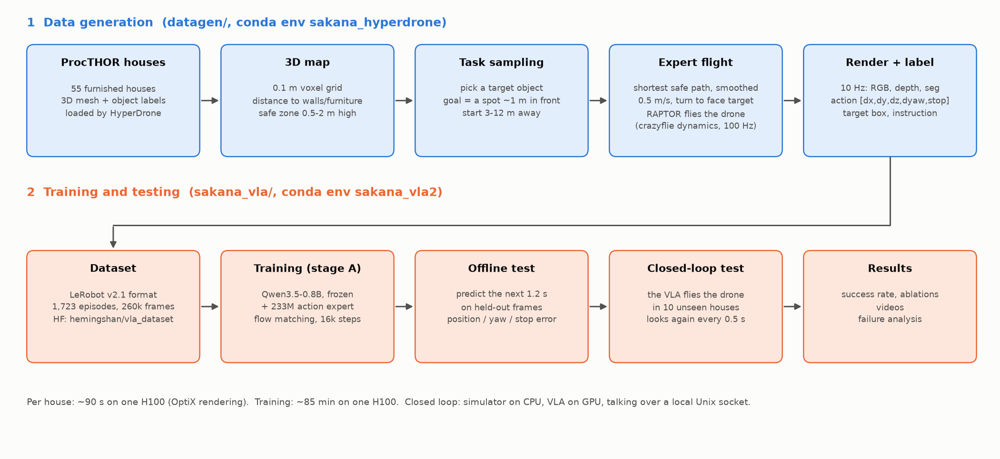

整个系统分两半，各用一个 conda 环境：

- **数据生成**（`datagen/`，环境 `sakana_hyperdrone`）：加载房子 → 建地图 → 出题 → 专家飞 → 渲染和标注 → 写成数据集。
- **训练和测试**（`sakana_vla/`，环境 `sakana_vla2`）：读数据集 → 训练 VLA → 离线测试 → 闭环测试 → 出结果和视频。

闭环测试时两边要同时跑：仿真器在 CPU 上（环境 `sakana_hyperdrone`），VLA 在 GPU 上（环境 `sakana_vla2`）。两个进程通过本机的 Unix socket 通信，不开网络端口。

代码目录：

```
Sakana_VLA/
├── datagen/            # 数据生成（场景、地图、出题、专家、渲染、标注、写数据集）
├── vla_data/           # 通用数据集读取（action chunk 构造）
├── sakana_vla/
│   ├── model/          # expert.py（动作专家）, vla.py（整体模型）
│   ├── data/           # frames_cache.py（解码视频缓存）, dataset.py（样本、归一化、划分）
│   ├── train.py        # 训练 + 离线评测
│   └── eval/           # policy_server.py, closed_loop.py, make_videos.py
├── scripts/            # 批量生成脚本, report_figures.py
└── docs/               # 本报告、v0_results.md、dataset_card.md、assets/
```

---

## 3. 数据集：怎么造出来的

### 3.1 场景

- 房子来自 ProcTHOR Train200，是带家具的程序化生成房子，由 HyperDrone 的渲染器 hyperlux 加载。
- 每个物体都带类别和语义分割编号，所以可以自动知道"电视在哪""画面里哪些像素是电视"。
- 房间的类型（厨房、卧室……）是根据房间里的家具推断出来的。

### 3.2 怎么出题

每条 episode 是一道题："从 A 飞到某个物体前面停下"。

1. **选目标**：在房子里选一个物体。要求这个类别在房子里只有一个（避免歧义），并且足够大。
2. **定终点**：在离物体边缘水平 0.6–1.4 m、比物体顶部稍高的地方找一个点作为终点视角，要求从那里能直接看到物体，并且物体在画面中。
3. **定起点**：起点和终点之间的最短可飞路程在 3–12 m 之间。可以和目标在同一个房间，也可以要穿过几个房间。
4. **可飞区域**：离地 0.5–2.0 m，离墙和家具至少 0.3 m。

### 3.3 专家怎么飞

专家不是"直接把规划路径当答案"，而是**真的用动力学飞一遍**，再把实际飞出来的状态当作标签：

1. **规划**：在 3D 地图上用 Dijkstra 找最短的安全路径，再拉直、用样条平滑。
2. **速度**：梯形速度曲线，最快 0.5 m/s，加速度 0.5 m/s²。
3. **朝向**：飞行时机头朝着前进方向，最后转向正对目标。
4. **控制**：RAPTOR 位置控制器驱动 L2F 的 crazyflie 四旋翼动力学，100 Hz。
   - 给控制器的设定点往前看 0.55 s，用来补偿跟踪滞后。
   - 高度加 5.3 cm 的前馈，补偿下垂。
   - 实际跟踪误差平均约 4 cm。
5. **扰动**：约一半的 episode 在飞行中途会被"推一下"（侧向 0.5–1 m/s，再加 15–45° 的转向扰动）。专家先维持 0.4 s 不动，再从被推偏的位置重新规划。这样数据里就有"偏了以后怎么回来"的例子。
6. **质检**：碰撞、跟丢、最后没停下、或者结束时看不到目标（少于 150 像素）的 episode 都会扔掉。

### 3.4 每帧记录了什么

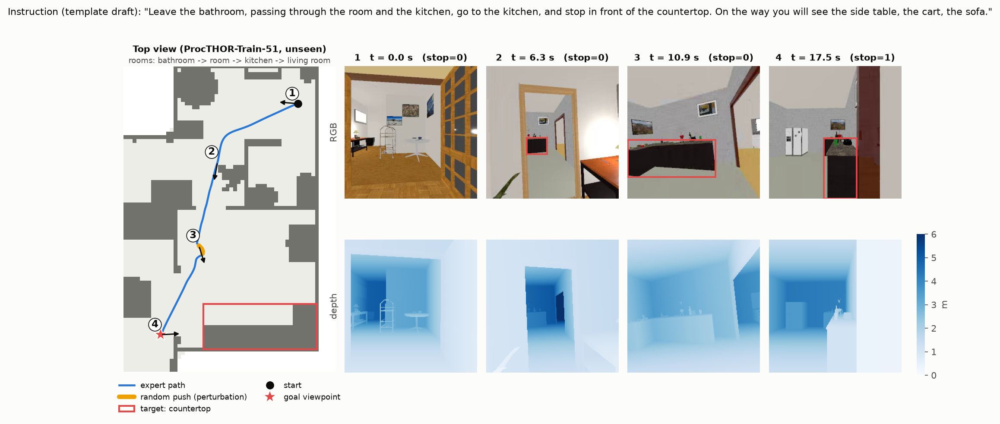

上图是没见过的房子 51 里的一条真实 episode：从卫生间出发，经过几个房间，停在厨房的台面（countertop）前。

- 左边是俯视图：蓝线是专家的路径，黄色是被推的那一段，红框是目标，红星是终点。
- 右边是第 ①–④ 个时刻的 RGB（红框是自动算出来的目标框）和深度图。

| 字段 | 内容 |
|---|---|
| `observation.images.rgb` | 256×256 RGB，视场角 90°，10 fps，AV1 视频 |
| depth（`depth/*.npz`） | 256×256 深度，uint16 毫米，最远 10 m |
| `observation.states` | `[x, y, z, yaw]`，相对起点（和 AeroBrain 一样） |
| `observation.state_full` | 13 维：位置、四元数、线速度、角速度（世界坐标） |
| `observation.boxes` | 目标框 `[x, y, w, h]`（归一化，左上角为原点） |
| `actions` | `[dx, dy, dz, dyaw, stop]`，见下节 |
| `actions_aerobrain` | `[dx, dy, dz, stop]`，和 AeroBrain 完全兼容 |
| `primitive` / `phase` | 13 类动作原语（前进、左转、上升……）/ fly、hover、perturb |
| `caption` | 指令（目前是模板草稿） |
| `meta/episodes_extra.jsonl` | 目标、起点、终点、经过的房间、动作分段、沿途看到的物体、跟踪误差等 |

### 3.5 动作怎么定义

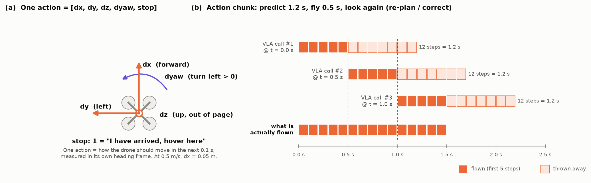

**(a) 一个动作**表示"接下来 0.1 秒怎么动"，用无人机自己的朝向作参照系：

- `dx`：往前，`dy`：往左，`dz`：往上。
- `dyaw`：转了多少角度，左转为正。
- `stop`：1 表示"到了，悬停"。

以 0.5 m/s 飞行时，`dx` 大约是 0.05 m。

**(b) 动作块（action chunk）**和 OpenFly v2 一样：

1. 模型每次预测未来 12 步（1.2 s）。
2. 只执行前 5 步（0.5 s）。
3. 然后重新看一眼图像，再预测一次。

这样既有一段完整的计划，又能边飞边修正。

### 3.6 指令

目前的指令是根据结构化信息自动拼出来的模板，例如：

- 同一个房间："Find the television in this living room and stop in front of it. On the way you will see the dining table, the tv stand, the sofa."
- 跨房间："Leave the bathroom, passing through the bedroom and the living room, go to the kitchen, and stop in front of the safe. On the way you will see the fridge, the countertop, the television."

所有结构化信息（目标、经过的房间、动作分段、关键帧图片）都已经存好，供你后面用 LLM 改写和人工校对。模板有明显的局限。比如上面图里那条，房间序列识别得不准，拼出了 "passing through the room and the kitchen, go to the kitchen" 这种重复的说法。这也是 LLM 改写要解决的问题之一。

### 3.7 规模和质检结果

| 子集 | 用途 | 房子 | 采样 → 保留 | 帧数 | 平均时长 | 平均路程 | 有扰动 | 跨房间 | 目标类别 |
|---|---|---|---|---|---|---|---|---|---|
| `indoor_nano` | 训练（最早的小样） | 5（1, 3–6） | 190 → 184 | 30,535 | 16.6 s | 6.7 m | 48% | 70% | 26 |
| `indoor_mini` | 训练 | 40（7–46） | 1,450 → 1,345 | 202,204 | 15.0 s | 5.9 m | 47% | 65% | 37 |
| `indoor_mini_unseen` | 测试（没见过的房子） | 10（47–56） | 200 → 194 | 27,101 | 14.0 s | 5.2 m | 44% | 47% | 21 |
| **合计** | | **55** | **1,840 → 1,723** | **259,840** | | | | | |

- 被扔掉的 117 条里，102 条是"结束时目标不够清楚"，15 条是碰撞。
- 用 1 张 H100（OptiX 渲染）生成，每栋房子大约 1.5 分钟。
- 磁盘占用约 6.7 GB（mini 5.2 GB，unseen 0.7 GB，nano 0.9 GB）。

---

## 4. 模型：结构怎么搭的

### 4.1 一句话

**VLM 负责"看懂"，动作专家负责"出动作"。**

- VLM 把图像和指令读一遍，把理解的结果存成每一层的 K/V。
- 动作专家每一步都"回头查看"这些 K/V，再把一团随机噪声逐步变成一段动作。

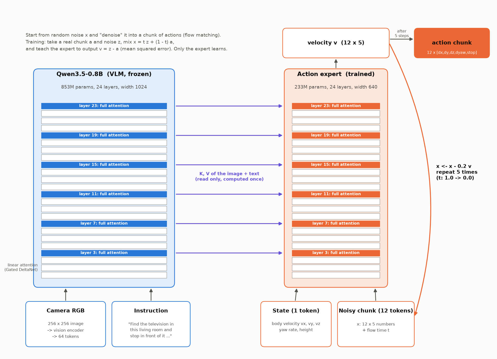

### 4.2 各部分

| 部分 | 大小 | 是否训练 | 作用 |
|---|---|---|---|
| Qwen3.5-0.8B（VLM） | 853M，24 层，宽 1024 | ❌ 冻结（stage A） | 读 RGB（64 个视觉 token）和指令文字 |
| 动作专家 | 233M，24 层，宽 640 | ✅ | 输入 1 个状态 token 和 12 个带噪动作 token，输出"去噪方向" v |
| 状态 token | 5 维 | ✅（投影层） | 机体系速度 vx, vy, vz、yaw 角速度、高度 |
| 动作输出层 | 640 → 5 | ✅（初始化为 0） | 每个动作 token 输出 5 个数 |

**两者怎么连起来。**

- Qwen3.5 是"混合"结构：每 4 层里有 3 层是线性注意力（Gated DeltaNet），1 层是普通的全注意力（第 3、7、11、15、19、23 层）。
- 动作专家照搬同样的层排布。它的 6 个全注意力层直接读 VLM 对应层的 K/V（π0 的做法）。
- 专家的注意力头数设成和 VLM 的 KV 头数一样（2 个头 × 256 维），所以 K/V 可以直接拿来用，不需要额外的投影。
- 线性注意力层只在专家自己的 13 个 token 上算。
- VLM 的 K/V 只算一次，去噪 5 步都复用它（代码里的 `PrefixKV` 是只读的）。

### 4.3 和 OpenFlyV2 的区别

| | OpenFlyV2 | SakanaVLA v0 |
|---|---|---|
| VLM | Qwen3.5 | Qwen3.5-0.8B ✅ 相同 |
| 动作专家 | 约 0.2B，读 VLM 的 K/V | 233M，读 VLM 的 K/V ✅ 相同（代码改编自 AeroBrain-project，Apache-2.0） |
| 生成方式 | flow matching | flow matching ✅ 相同 |
| MAM（运动记忆） | 有 | **去掉** |
| MSP（模板运动先验） | 有，噪声从运动先验出发 | **去掉**，噪声就是标准高斯 |
| VQA 联合训练 | 有 | **去掉** |
| 历史帧 | Base 版有 4 帧历史 | **没有**，只看当前帧（v1 要加回来） |

### 4.4 Flow matching 通俗理解

可以把它想成"把一团乱码一步步修成正确的动作"。

- **训练时**：
  1. 拿一段真实动作 a 和一段随机噪声 z，随机选一个比例 t，混成 x = t·z + (1−t)·a。
  2. 让专家猜"从 x 往哪个方向走能回到 a"，正确答案是 v = z − a，用均方误差训练。
  3. t 的分布偏向噪声多的一端：t = 0.999·Beta(1.5, 1) + 0.001。
- **推理时**：
  1. 从纯噪声出发（t = 1）。
  2. 每步 x ← x − 0.2·v，一共 5 步，到 t = 0 就得到动作块。
  3. 闭环时每条 episode 固定用同一份噪声，这样前后两次预测比较一致，不会来回摇摆。

### 4.5 动作的归一化

- 每个通道（dx, dy, dz, dyaw）用训练集的 99.5% 分位数做对称缩放，缩到大约 [−1, 1]。
- `stop` 从 {0, 1} 映射到 {−1, 1}。
- 推理时反变换回来；stop 大于 0.5 就算"要停"。

---

## 5. 训练

| 项目 | 设置 |
|---|---|
| 训练数据 | `indoor_nano` + `indoor_mini`（45 栋房子），随机留 5% 的 episode 作 val_seen，训练帧约 22 万 |
| 测试数据 | val_seen（训练房子里留出的 episode）和 val_unseen（`indoor_mini_unseen`，10 栋没见过的房子） |
| 样本 | 当前 RGB + 指令 + 当前状态 → 未来 12 步动作；episode 结尾不足 12 步时用 stop=1 补齐 |
| 阶段 | Stage A：VLM 冻结，只训练动作专家 |
| 优化器 | AdamW（β = 0.9 / 0.95，weight decay 0.01），lr 1e-4，前 500 步 warmup，之后 cosine 衰减 |
| 批大小和步数 | 64 × 16,000 步（约 100 万个样本，约 4.6 个 epoch） |
| 精度 | bf16 autocast，梯度裁剪 1.0 |
| 硬件和时间 | 1 × H100，约 85 分钟 |
| 预处理 | 先把视频解码成 memmap 缓存（`data/cache/v1`，51 GB），训练时直接读，不用边训边解码 |

**先做的两个健全性检查：**

1. **过拟合单个 batch**（`--overfit-batch`，32 个样本，600 步）：ADE 从第 200 步的 10.2 cm 降到第 600 步的 1.1 cm（匀速外推是 5.5 cm），stop F1 = 1.0。说明模型能学，梯度通路是通的。
2. **只用 nano 的小规模训练**（5 栋房子，8k 步）：在没见过的房子 6 上，ADE 3.6 cm，匀速外推是 5.8 cm。说明能泛化，所以接着扩大到 mini。

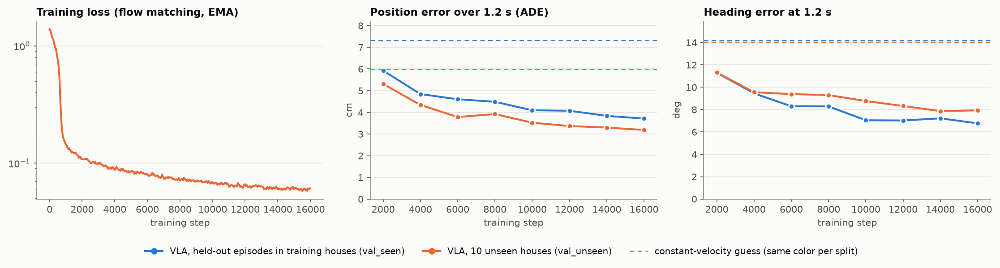

- 训练 loss 在前 1,000 步迅速下降，之后缓慢下降，没有发散。
- 离线误差在两个验证集上都稳步下降，一直明显低于匀速外推基线（虚线）。
- 没见过的房子（橙）和见过的房子（蓝）误差差不多，说明在"短时间怎么飞"这件事上没有过拟合到具体房子。

---

## 6. 怎么测试

### 6.1 离线测试

在验证帧上，让模型预测未来 1.2 s 的动作块（5 步去噪），和专家真值比：

- **ADE**：12 个预测航点和真值航点的平均距离。
- **FDE**：最后一个航点（1.2 s 处）的距离。
- **朝向误差**：1.2 s 处累计转角的误差。
- **stop F1**：预测"这段里要停"和真值是否一致。
- **基线**：匀速外推，即假设无人机保持当前速度和转速。

每个验证集抽 512 个样本。

### 6.2 闭环测试

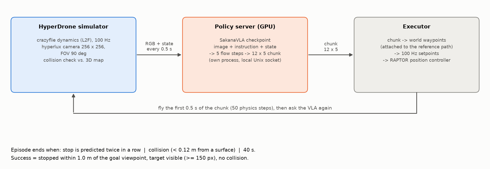

离线误差小不代表能飞好，所以最重要的是闭环测试：让 VLA 自己开飞机。

1. 仿真器把无人机放在起点，朝向和数据集里一样（随机）。
2. 每 0.5 s 渲染一张当前画面，连同指令和状态发给 policy server。
3. VLA 返回 12 × 5 的动作块。
4. 执行器把它变成世界坐标航点，插值成 100 Hz 的设定点，交给 RAPTOR 控制器（和造数据时的设置一样）。
5. 飞 0.5 s 后回到第 2 步。

**结束条件**：连续两次预测 stop、撞了（离物体表面不到 0.12 m），或者超过 40 s。

**成功的定义**：主动停下，离终点不超过 1.0 m，目标在画面里（至少 150 像素），没有碰撞。

**测试集**：从 10 栋没见过的房子里固定抽 32 条 episode，16 架无人机并行仿真。

**对照实验：**

- **专家回放**：不用模型，把专家自己的动作块喂给同一个执行器。用来检查执行器和评测流程本身有没有问题。
- **遮住图像**（black images）：给模型全黑的图。看模型到底用没用视觉。
- **打乱指令**（shuffled instructions）：把同一批里的指令随机互换。看模型到底用没用语言。

---

## 7. 测试结果

### 7.1 离线：短时间的动作学得很好

| 数据 | ADE | FDE | 朝向误差 @1.2 s | stop F1 | 匀速外推 ADE / FDE / 朝向 |
|---|---|---|---|---|---|
| val_seen（训练房子，留出的 episode） | 3.7 cm | 6.9 cm | 6.8° | 0.95 | 7.3 cm / 15.4 cm / 14.2° |
| **val_unseen（没见过的 10 栋房子）** | **3.2 cm** | **6.3 cm** | **7.9°** | **0.88** | 6.0 cm / 12.8 cm / 14.0° |

位置误差大约是基线的一半，朝向误差也大约是基线的一半。在没见过的房子上同样成立。

### 7.2 闭环：端到端还不能完成任务

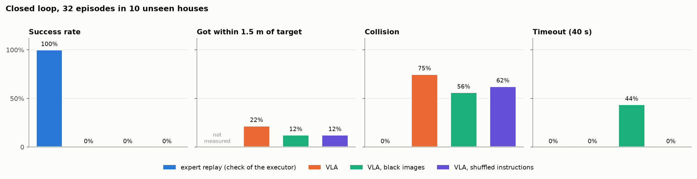

| 策略（32 条，没见过的房子） | 成功率 | 飞到过目标附近 | 结束时在目标附近 | 终点误差 | 碰撞 | 主动停下 | 超时 |
|---|---|---|---|---|---|---|---|
| 专家回放（执行器自检） | **100%** | 未测 | 未测 | 0.06 m | 0% | 100% | 0% |
| **VLA** | 0% | **22%** | 12.5% | 4.26 m | 75% | 25% | 0% |
| VLA，遮住图像 | 0% | 12.5% | 9.4% | 4.39 m | 56% | **0%** | 44% |
| VLA，打乱指令 | 0% | 12.5% | 9.4% | 4.41 m | 63% | 37.5% | 0% |

（"目标附近"指离目标物体的包围盒不超过 1.5 m。）

怎么读这张表：

- **专家回放 100% 成功**：仿真、执行器和评测都没问题，失败确实出在模型上。
- **VLA 成功率 0%**：没有一条完成任务。但有 22% 飞到过目标附近，说明它不是在乱飞。
- **遮住图像以后，模型一次都不停**（全部碰撞或超时）：模型判断"到了没有"是靠图像的。
- **遮图像或打乱指令以后，飞到目标附近的比例从 22% 掉到 12.5%**：视觉和语言都在起作用，只是作用还太弱。
- **75% 碰撞**：一旦偏离专家的路线，模型就进入没见过的状态，误差越来越大。

### 7.3 中间发现并修好的一个执行器问题

最开始专家回放的成功率只有 3%。这说明问题在执行器，不在模型。

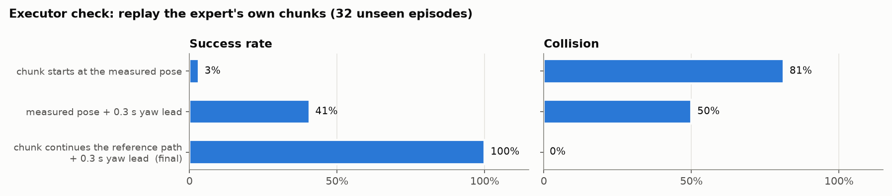

**原因。** RAPTOR 控制器跟踪有滞后，转弯时 yaw 大约落后 0.2 rad。最初每拿到一个新的动作块，都从无人机当前**实测**的位置和朝向开始接。这样每 0.5 s 都会把"还没转完的那部分"丢掉，结果总是转不够，越飞越偏。

**修复。** 动作块接在**连续的参考轨迹**上（就像专家造数据时那样），增量仍然用实测朝向换算到世界坐标；朝向设定点再往前看 0.3 s。

| 执行器（专家回放，32 条） | 成功率 | 碰撞 |
|---|---|---|
| 从实测位姿接上，不提前 | 3% | 81% |
| 从实测位姿接上，朝向提前 0.3 s | 41% | 50% |
| 接在参考轨迹上，不提前 | 94% | 6% |
| **接在参考轨迹上，朝向提前 0.3 s（现在的默认）** | **100%** | **0%** |

这个修复对以后所有闭环实验都有效，已经是 `closed_loop.py` 的默认设置。

### 7.4 视频

从 10 栋没见过的房子里挑了 6 条，模型和专家回放各飞一次。

**画面说明：**

- 顶部：指令原文，以及模型和专家各自的最终结果。
- 左：模型的机载画面。绿点是这次预测的航点，左上角是状态和 stop 概率。
- 中：同一题的专家回放。
- 右：俯视图。橙线是模型，蓝线是专家，红框是目标，红星是终点。

下面是 GIF 预览（4 fps）；点链接可以下载原始 mp4（10 fps）。

**总体结果。** 专家回放 6/6 成功，终点误差平均 4 cm。模型 0/6 成功，其中 3/6 飞到过目标附近。

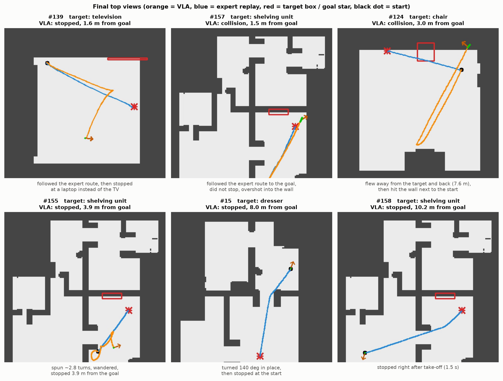

#### #139　目标：电视（同一房间）　→ 认错了目标

模型前半段和专家路线几乎重合，然后拐向一张书桌，停在一台**笔记本电脑**前面（stop 概率 1.00），离终点 1.6 m。专家停在电视前。下图是两边最后一帧的对比：

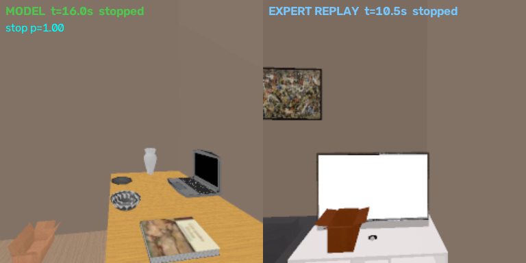

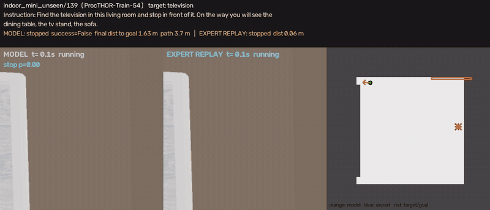

[mp4](assets/videos/ep139.mp4)

#### #157　目标：置物架（同一房间）　→ 到了却没停

模型几乎完全沿着专家路线飞到了终点，但一直没有预测 stop，飞过头撞到墙上。

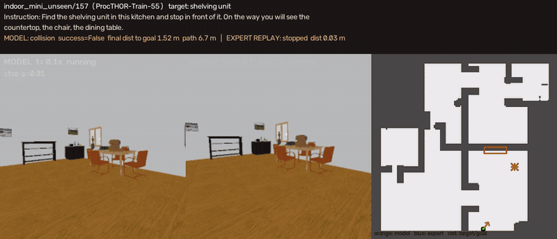

[mp4](assets/videos/ep157.mp4)

#### #124　目标：椅子（同一房间，最短路程 3.8 m）　→ 往反方向飞

起点离目标很近，但模型先飞离起点约 3.3 m（方向不对，离终点反而更远了），又飞回来（总路程 7.6 m，累计转了约 250°），最后在起点附近撞墙。

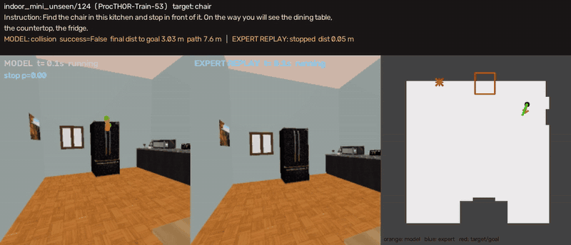

[mp4](assets/videos/ep124.mp4)

#### #155　目标：置物架（同一房间）　→ 原地打转

模型在起点附近转了约 2.8 圈（累计约 1000°），在厨房里乱转，最后停在离终点 3.9 m 的地方。

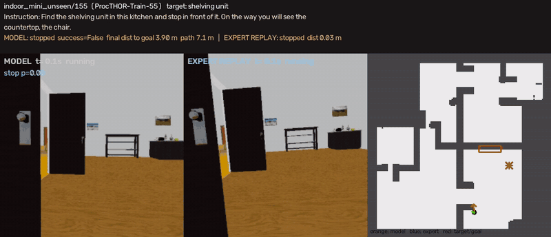

[mp4](assets/videos/ep155.mp4)

#### #15　目标：梳妆台（要从客厅去卧室）　→ 在起点停下

模型在原地转了约 140°，5 秒后就在起点预测 stop（总共只移动了 5 cm）。

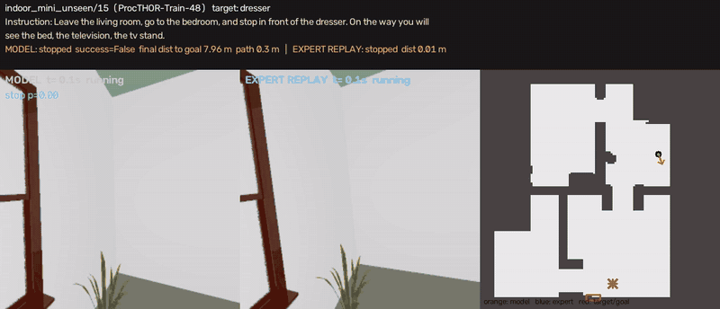

[mp4](assets/videos/ep15.mp4)

#### #158　目标：置物架（要从客厅去厨房，11 m）　→ 刚起飞就停

起飞 1.5 s 就判断"已经到了"，原地停下。

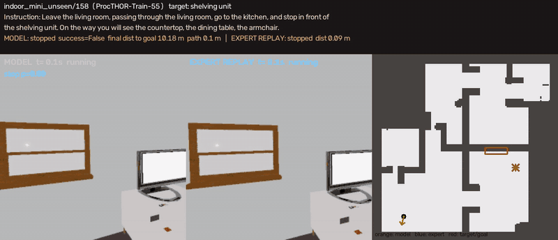

[mp4](assets/videos/ep158.mp4)

---

## 8. 问题分析：为什么闭环不行

把视频和数字放在一起看，失败基本可以归成三类。

**1. 分不清"刚起飞"还是"已到达"（#15, #158）。**

- 起点时无人机在悬停，速度为 0，和到达终点时的状态一模一样。
- 起点朝向是随机的，目标通常不在画面里。
- 模型只看当前一帧，没有"我已经飞了多久、飞了多远"的信息，所以有时一开始就预测 stop。

**2. 方向乱，原地转（#124, #155）。**

- 在起点，往左转和往右转可能都合理，所以数据里本来就是"多解"的。
- 模型每 0.5 s 重新决策一次，又没有记忆。这一次想左转，下一次想右转，结果就是打转，或者走反方向。

**3. 看不准目标、不会停（#139, #157）。**

- 能飞到目标附近，但会认错（把笔记本电脑当成电视），或者到了却不停。
- VLM 是冻结的，而且训练数据里的指令全是模板句，所以模型很难学到"指令里的 television 对应画面里的哪个东西"。
- 遮住图像以后模型完全不停，说明"停"是靠视觉判断的。但这个视觉判断还很粗糙。

**另外：误差会累积。** 飞行途中的单步预测其实很准（离线只有几厘米误差）。但只要偏离专家路线一点，后面看到的画面就是训练里没见过的，误差越积越大，最后撞墙（碰撞率 75%）。数据里只有约一半的 episode 有一次轻微扰动，"纠偏"的例子太少。

---

## 9. 下一步（v1）

按预计收益排序：

1. **加历史信息**（对应问题 1 和 2）：像 OpenFlyV2 的 Base 配置一样，输入 4 张历史帧加当前帧（约 320 个视觉 token）；或者先简单地在状态里加"已飞时间、已飞距离、最近的运动"。这样能区分起点和终点，转向决策也能前后一致。
2. **Stage B：放开 VLM 一起训练**（对应问题 3）：VLM 学习率 1e-5。再加一个辅助任务：根据指令预测目标框，监督信号直接用数据里现成的 `observation.boxes`。
3. **数据**：
   - 用 LLM 改写指令，再人工校对。结构化信息和关键帧都已经准备好。
   - 用更多房子（Train200 一共 200 栋，现在只用了 55 栋）。
   - 更多、更强的扰动和纠偏数据（DAgger 式：让模型飞，专家在旁边给正确答案）。
   - 起点朝向偏向第一段路径，减少开局的多解问题。
4. **评测**：固定 64 条没见过的 episode，加上 val_seen，保留遮图像和打乱指令两组对照。32 条的统计波动比较大。

还有两件小事：

- 把 `indoor_mini` 和 `indoor_mini_unseen` 上传到 HF。
- 训练房子上的闭环测试（val_seen）因为 GPU 时间到期没有跑完，下一轮补上。

---

## 10. 复现

```bash
# 数据生成（环境 sakana_hyperdrone，需要 GPU 渲染；先按房子分段生成，再合并）
bash scripts/run_range.sh indoor_mini_train_a 7-19 40 107   # <part> <houses> <episodes_per_house> <seed>，写到 data/vla_parts/
PYTHONPATH=. python -m datagen.merge_subsets --parts data/vla_parts/indoor_mini_train_* --out data/vla_dataset/indoor_mini

# 训练（环境 sakana_vla2）
conda activate sakana_vla2   # torch 2.7.1 cu126, transformers 5.5.0, flash-linear-attention
python -m sakana_vla.data.frames_cache --subsets data/vla_dataset/indoor_{nano,mini,mini_unseen} --out data/cache/v1
python -m sakana_vla.train --cache data/cache/v1 --out runs/v1_stageA --steps 16000 --bs 64 --eval-every 2000

# 闭环测试（环境 sakana_hyperdrone；会自动启动 sakana_vla2 里的 policy server）
PYTHONPATH=. python -m sakana_vla.eval.closed_loop --run runs/v1_stageA --split val_unseen --limit 32 --max-seconds 40 --tag main
#   对照：--server-args '--blind' / --server-args '--shuffle-instructions' / --oracle-replay（专家回放）

# 视频：录制 → 合成
PYTHONPATH=. python -m sakana_vla.eval.closed_loop --run runs/v1_stageA --split val_unseen --max-seconds 40 \
    --ids indoor_mini_unseen/139 indoor_mini_unseen/157 ... --record --tag video
PYTHONPATH=. python -m sakana_vla.eval.closed_loop ... --oracle-replay --record --tag video_expert
PYTHONPATH=. python -m sakana_vla.eval.make_videos --model runs/v1_stageA/closed_loop_val_unseen_video \
    --expert runs/v1_stageA/closed_loop_val_unseen_video_expert --out runs/v1_stageA/videos

# 本报告的图
PYTHONPATH=. python scripts/report_figures.py --out docs/assets
```

---

## 附录 A：关键参数一览

| 类别 | 参数 | 值 |
|---|---|---|
| 仿真 | 物理频率 / 记录频率 | 100 Hz / 10 Hz |
| 仿真 | 机型 / 控制器 | L2F crazyflie / RAPTOR 位置控制 |
| 专家 | 巡航速度 / 加速度 | 0.5 m/s / 0.5 m/s² |
| 专家 | 设定点前瞻 / 高度前馈 | 0.55 s / +5.3 cm |
| 专家 | 扰动概率 / 强度 | 50% / 侧向 0.5–1 m/s + 转向 15–45°，0.4 s 后重规划 |
| 任务 | 起终点最短路程 / 终点离目标 | 3–12 m / 0.6–1.4 m |
| 任务 | 飞行高度 / 最小离墙距离 | 离地 0.5–2.0 m / 0.3 m |
| 相机 | 分辨率 / 视场角 | 256×256 / 90° |
| 模型 | 动作块长度 / 每次执行 | 12 步（1.2 s）/ 5 步（0.5 s） |
| 模型 | 去噪步数 | 5（Euler） |
| 闭环 | 停止规则 | 连续 2 次预测 stop |
| 闭环 | 碰撞阈值 / 时间上限 | 离表面 0.12 m / 40 s |
| 闭环 | 成功判定 | 停下，离终点 ≤ 1.0 m，目标 ≥ 150 像素，无碰撞 |
| 闭环 | 朝向提前量 | 0.3 s |

## 附录 B：已知问题和注意事项

- **指令是模板句**：有时房间序列会重复或识别成笼统的 "room"（见 3.6 节）。在 LLM 改写之前，不要把它当成自然语言评测。
- **闭环测试样本少**：32 条，"飞到过目标附近"的 22% 对 12.5%，只相差 3 条 episode。结论只能当作趋势看。
- **起点朝向随机**：这让开局本身就是多解的，对没有历史的模型尤其不利。
- **登录节点不能加载 hyperlux**（没有 CUDA target）：数据生成和闭环测试要在计算节点上跑。
- **HF 上传**：目前只有 `indoor_nano` 在 HF 上。
