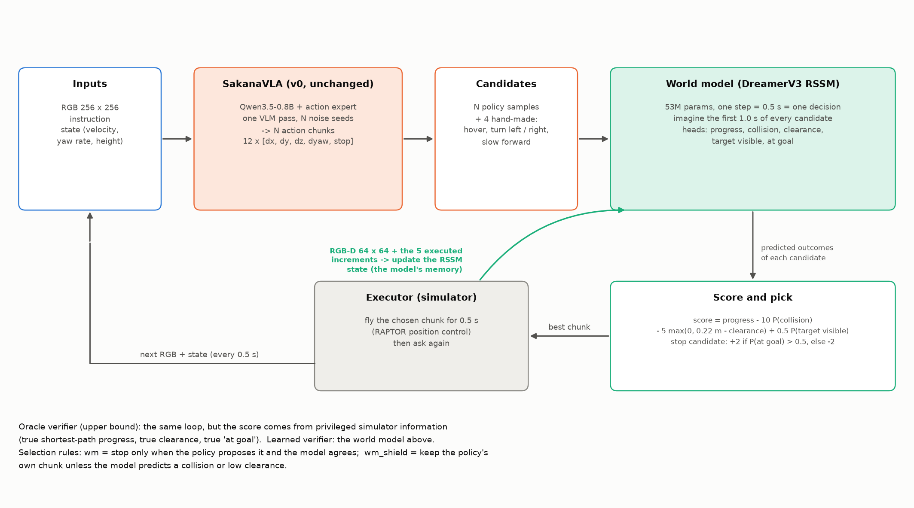
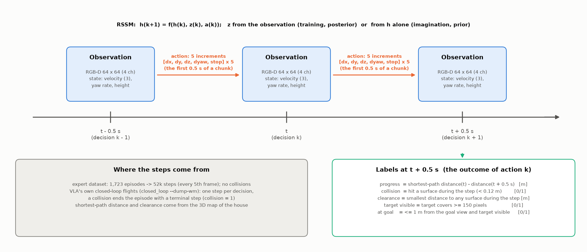
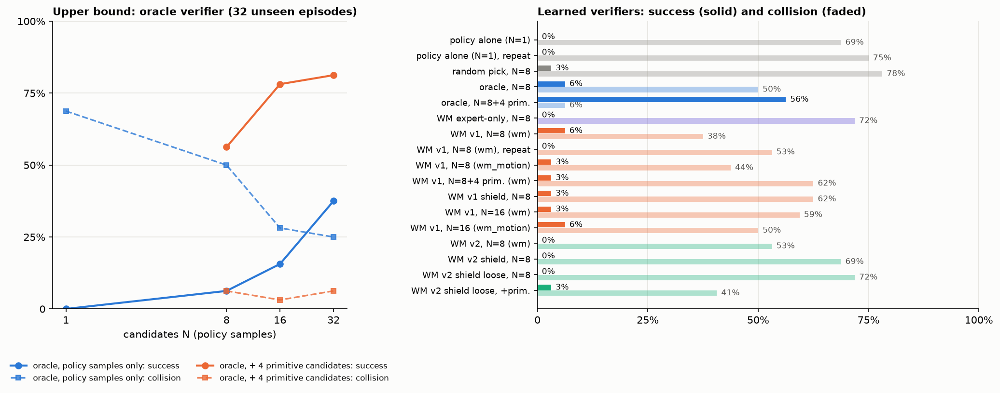

# SakanaVLA 第二阶段报告（v1）：把 Dreamer 世界模型接到 VLA 上

日期：2026-11-10　|　代码：[MingshanHe/Sakana_VLA](https://github.com/MingshanHe/Sakana_VLA)，分支 [`wm-verifier`](https://github.com/MingshanHe/Sakana_VLA/tree/wm-verifier)　|　上一阶段：[report.md](report.md)

这份报告接着 [report.md](report.md)（v0）往下写。v0 的结论是：VLA "怎么飞"学会了，"往哪飞、什么时候停"没学会，闭环成功率是 0。这一阶段我们没有改 VLA 本身，而是在它旁边加了一个 DreamerV3 世界模型，让 VLA 一次提出多个动作，由世界模型在"想象"里替它挑一个。这一阶段的全部代码都在分支 `wm-verifier` 上，还没有合并进 master。本文用最简单的话说清楚：为什么这样做，怎么接的，用什么数据训练，怎么测，结果如何，问题出在哪，下一步做什么。图可以用 `scripts/report_figures.py --only wm_arch wm_step` 重新生成，结果图来自分支上的 `scripts/wm_results_figure.py`。

---

## 0. 一页总结

**想法。** VLA 的动作专家是 flow matching，同一个画面换一份噪声就会给出另一个动作块，本来就是"多解"的。v0 失败的那些时刻（起点乱转、提前 stop、撞墙），往往不是所有候选都错，而是**不会挑**。所以让 VLA 一次采 N 个候选，再找一个"裁判"挑出最好的那个。裁判用 DreamerV3 的世界模型：输入当前画面和候选动作，在潜空间里想象 1 秒之后会不会撞、离目标近了多少、能不能看到目标。

**做了什么。**

1. **上限实验。** 先用仿真的"上帝视角"当裁判（知道真实的最短路程和离墙距离），测出这条路最多能走多远。
2. **世界模型。** 复用 Sakana_WAM 里的 DreamerV3（RSSM），改成"一步 = 0.5 秒 = 一次决策"，加了进度、碰撞、离障距离、目标可见、已到达五个预测头。53M 参数。
3. **数据。** 专家数据集按 0.5 秒导出，再加上 VLA 自己在闭环里飞出来的数据（包括撞墙的）。
4. **接入闭环。** policy server 同时跑 VLA 和世界模型；每次决策给 N 个候选打分，按规则选一个执行。

**结果（32 条没见过的房子里的 episode，和 v0 同一批）。**

| 裁判 | 候选 | 成功率 | 碰撞率 | 说明 |
|---|---|---|---|---|
| 没有裁判（v0） | 1 | 0% | 69–75% | 基线 |
| 上帝视角 | 8 / 16 / 32 个 VLA 样本 | 6% / 16% / 38% | 50% / 28% / 25% | 候选越多，上限越高 |
| 上帝视角 | 16 个样本 + 4 个手工候选 | **78%** | **3%** | 同一个 VLA，只是有人替它"别停、别撞" |
| 学出来的世界模型（v1） | 8 个样本 | 6% → 重跑 0% | **38% → 重跑 53%** | 碰撞明显减少，成功率没有可靠提升 |
| 学出来的世界模型（v1） | 16 个样本 | 3% | 59% | 候选变多反而变差 |

**一句话结论。** 上限很高：v0 这个 VLA 其实"会飞"，缺的是三个判断：别停、别撞、往哪转。学出来的世界模型目前只学会了"别撞"（一步碰撞预测 AUC 0.95，闭环碰撞率从约 72% 降到约 45%）。"别停"和"往哪转"都还没学会，所以成功率没跟上。原因在第 8 节：世界模型不知道目标在哪，"已到达"头学到了一个捷径，打分本身还带随机性。

**下一步（最重要的三件）。** 1）把裁判的打分改成确定性的，再评一遍；2）修"已到达"头，让它能真的否决乱停；3）给世界模型目标信息，或者直接向上帝视角的打分学习。详见第 9 节。

---

## 1. 这一阶段完成的工作

| # | 工作 | 产出 | 位置（分支 `wm-verifier`） |
|---|---|---|---|
| 1 | VLA 多候选采样：一次 VLM 前向，N 份固定噪声 | `sample(n_samples)` | `sakana_vla/model/vla.py` |
| 2 | 4 个手工候选：悬停、原地左转 / 右转、慢速前进 | `primitive_chunks` | `sakana_vla/wm/labels.py` |
| 3 | 上帝视角裁判（上限）和各种选择规则 | `--candidates --select oracle/wm/wm_shield` | `sakana_vla/eval/closed_loop.py` |
| 4 | 世界模型：DreamerV3 RSSM + 5 个预测头 | `ChunkWorldModel` | `sakana_vla/wm/model.py`, `wm/dv3/` |
| 5 | 专家数据导出成世界模型训练数据 | `data/wm/expert`，1,723 条 | `sakana_vla/wm/export_replay.py` |
| 6 | 闭环里采 VLA 自己飞的数据 | `data/wm/onpolicy_*`，544 条 | `closed_loop.py --dump-wm` |
| 7 | 世界模型训练和验证 | `runs/wm_expert`, `wm_v1`, `wm_v2` | `sakana_vla/wm/train_wm.py`, `replay.py` |
| 8 | 世界模型接进 policy server 当裁判 | `--wm <ckpt>` | `sakana_vla/wm/verifier.py`, `eval/policy_server.py` |
| 9 | 离线检验裁判质量 | 碰撞 AUC、进度相关性等 | `sakana_vla/wm/eval_wm.py` |
| 10 | 批量实验脚本、结果表、图 | 30 多次闭环运行 | `scripts/wm_pipeline.sh`, `run_sim.sh`, `bestofn_table.py`, `wm_results_figure.py` |
| 11 | 集群上 hyperlux 卡死的修复 | 闭环一轮从 4–6 分钟降到 1–3 分钟 | `datagen/_jitfix.py`, `scripts/run_sim.sh` |
| 12 | 计划和报告 | 本文、[wm_verifier_plan.md](wm_verifier_plan.md)、[v1_plan.md](v1_plan.md) | `docs/` |

---

## 2. 为什么要把 Dreamer 接到 VLA 上

**v0 的三个问题**（[report.md](report.md) 第 8 节）可以翻译成三个判断：

| v0 的问题 | 需要的判断 |
|---|---|
| 起点就 stop，或者到了目标附近认错物体停下 | **别停**：现在不该停 |
| 偏离路线后撞墙（碰撞率 75%） | **别撞**：这个动作会撞 |
| 起点左右乱转、进错房间 | **往哪转**：哪个方向离目标更近 |

**一个关键观察。** flow matching 的专家从随机噪声出发，噪声不同，输出就不同。v0 的分析里已经看到：起点时不同采样给出的转向互相矛盾，有的 stop 有的不 stop。换句话说，候选里**常常有对的**，只是模型自己不知道哪个对。

**所以分成两个角色。**

- **提案者**：现在的 VLA，不改。一次采 N 个候选动作块。
- **裁判**：一个世界模型。把每个候选"想象"一遍，预测会不会撞、能不能靠近目标，然后挑最好的。

**为什么用 Dreamer。** DreamerV3 的世界模型（RSSM）在潜空间里做预测，想象 16 个候选 × 1 秒只要几毫秒，跟得上无人机每 0.5 秒一次的决策。相比之下，现在同类工作（比如 Navigation World Models）大多用像素级的视频世界模型，1B 参数、秒级推理，只能用在机械臂上。另外 RSSM 的循环状态天然是历史的压缩，以后还可以当 VLA 的"记忆"用，正好补 v0 没有历史的短板。Dreamer 原本的用法是"在想象里训练策略"，我们先做更简单的一步："在想象里挑动作"。

**别人做到哪了**（细节见 [wm_verifier_plan.md](wm_verifier_plan.md) 第 2 节）：用价值函数或 VLM 给 VLA 的多个采样重排（V-GPS、RoboMonkey、RoVer），用视频世界模型给导航提案排序（NWM），在像素世界模型里做 RL 微调（WMPO）。没有人做的是：潜空间实时 + 无人机导航 + 世界模型兼做记忆 + flow 专家的想象微调。这一阶段先把第一步"挑动作"做通，顺便测出整条路的上限。

---

## 3. 怎么接的：结构



每 0.5 秒一轮：VLA 提出候选 → 世界模型想象每个候选的后果 → 打分、选一个 → 执行 0.5 秒 → 把新画面和实际执行的动作喂回世界模型，更新它的状态 → 下一轮。

### 3.1 提案者：VLA 一次给 N 个候选

- VLM（Qwen3.5-0.8B）对图像和指令只算**一次**，得到的 K/V 复制 N 份；动作专家用 N 份不同的噪声各自去噪 5 步，得到 N 个动作块。多采 7 个候选只多花专家的那一点时间。
- 每条 episode、每个候选位置的噪声是固定的（种子 = episode 的 id + 7919 × 候选序号），这样前后两次决策里"第 3 个候选"是同一种风格，不会来回摇摆。
- 可选再加 **4 个手工候选**：悬停、原地左转 0.8 rad/s、原地右转、慢速前进 0.3 m/s。它们给裁判提供"安全的备选项"：当 VLA 的所有候选都要撞或者都想停时，裁判至少可以选"先转一转看看"。

### 3.2 裁判：DreamerV3 世界模型



**一步 = 0.5 秒 = 一次决策。** 这是和 Sakana_WAM 里原版 Dreamer 最大的不同。原版一步是一个物理帧，这里一步就是 VLA 的一次决策，动作是这 0.5 秒里执行的 5 个增量（25 个数）。这样想象 2 步就是 1 秒，正好覆盖一个候选块会被执行的部分再多一点。

| 部分 | 内容 |
|---|---|
| 图像输入 | RGB-D 缩到 64×64，4 通道（深度裁到 10 m） |
| 向量输入 | VLA 用的 5 维状态：机体系速度 3 个、yaw 角速度、高度。**不给目标位置、不给指令** |
| 动作输入 | 5 个增量 `[dx, dy, dz, dyaw, stop]`，共 25 个数，按固定比例放大到 [−1, 1] 附近 |
| 核心 | DreamerV3 的 RSSM（size50m 预设：确定性状态 4096 维，32 × 32 个离散隐变量），共 53M 参数 |
| 重建头 | 图像和向量的重建（Dreamer 标配，用来学好潜空间） |
| 预测头 | **进度**（到终点的最短路程这一步减少了多少米，two-hot 回归）、**不碰撞**（Bernoulli）、**最小离障距离**（symlog 回归）、**目标可见**（≥ 150 像素）、**已到达**（离终点 ≤ 1 m 且目标可见） |

训练时 RSSM 看着真实观测更新状态（后验），想象时只靠自己的状态往前推（先验）。每个预测头都从潜状态出发，所以想象出来的状态也能给出这五个预测。

### 3.3 打分和选择

每个候选取前 2 步（1 秒）的动作送进世界模型想象，得到五个预测，合成一个分数：

> 分数 = 进度 − 10 × P(撞) − 5 × max(0, 0.22 m − 最小离障距离) + 0.5 × P(目标可见)

- 进度的单位是米，1 秒最多 0.5 m 左右；一次预测到的碰撞就扣 10，所以"别撞"的优先级远高于"多飞一点"。
- stop 候选不想象，按当前状态的"已到达"概率打 ±2。

选择规则（`--select`）：

| 规则 | 怎么选 | 用途 |
|---|---|---|
| `first` | 永远用第 1 个候选 | 基线（等于 v0） |
| `random` | 随机挑一个 | 对照：多采样本身有没有用 |
| `oracle` | 用仿真的特权信息打分（见 3.4），选最高分 | **上限** |
| `wm` | 动作按世界模型的分数选；**stop 只在 VLA 自己提出、且世界模型"已到达" > 0.5 时才执行** | 主要的学出来的裁判 |
| `wm_motion` | 动作按分数选，stop 完全听 VLA 的 | 消融：世界模型不管停 |
| `wm_shield` | 默认用 VLA 自己的第 1 个候选，只在世界模型预测它会撞（P(不撞) < 0.7 或离障 < 0.2 m）时换成最安全的候选 | 只做安全过滤 |

闭环里每次决策同时算上帝视角的分数，记录学出来的裁判和上帝视角选同一个候选的比例（**top-1 一致率**）和分差（**regret**，单位米）。这样可以直接看裁判"挑得准不准"，不用等闭环结果。

### 3.4 上帝视角裁判（上限）

和 3.3 同一个公式，但每一项用仿真里的真值：沿候选块飞 1.2 秒后到终点的最短路程减少了多少（用生成数据时的 `GoalField`）、路径上的最小离墙距离（3D 地图）、是不是真的到了（≤ 1 m 且目标 ≥ 150 像素）。stop 候选：真的到了给 +10，没到给 −10。它的作用是回答"如果裁判完美，这个 VLA 能到多少"。

### 3.5 和 v0 相比改了什么

- **VLA 没有变**：还是 `runs/v1_stageA` 那个 checkpoint，没有重新训练。
- **执行器没有变**：仍然是参考轨迹锚定 + 0.3 s 朝向提前量（v0 修好的那一版）。
- **policy server** 多了：N 个候选、手工候选、加载世界模型、按 episode 维护 RSSM 状态并打分。
- **closed_loop** 多了：候选选择、上帝视角打分、裁判质量统计、把每条 episode 存成世界模型的训练数据（`--dump-wm`）、每条 episode 自己的结束时间（v0 里 `frames` 记的是整批的）、第一次 stop 投票时"继续飞"的选项（`--tentative-stop continue`，测了没有帮助）。

---

## 4. 数据：世界模型拿什么训练

### 4.1 两个来源

**专家数据集**（`export_replay.py`）：把 v0 的 1,723 条 episode 每隔 5 帧取一个点，就是一步。标签都能离线算出来：最短路程用每栋房子的 `GoalField`，离障距离查 3D 地图，目标像素数据集里有。共约 52.6k 步。专家从不撞墙，所以这里**没有一个碰撞样本**。

**VLA 自己飞的数据**（`closed_loop --dump-wm`）：闭环里每次决策存一步，撞墙时多存一个"终止步"（碰撞 = 1）。这是必须的：只看过专家数据的世界模型没见过 VLA 的怪动作（原地打转、飞向墙），也没见过碰撞，就没法判断它们。

| 批次 | 怎么飞的（训练房子，各 128 条，30 s 上限） | 成功率 | 碰撞率 | 用途 |
|---|---|---|---|---|
| `onpolicy_v0` | VLA 自己，N=1 | 1% | 52% | v1、v2 |
| `onpolicy_v0_rand` | N=4 随机挑，每次换噪声 | 2% | 59% | v1、v2 |
| `onpolicy_v0_orc` | N=8 + 手工候选，上帝视角挑 | 48% | 3% | v2 |
| `onpolicy_v0_randp` | N=8 + 手工候选，随机挑 | 2% | 36% | v2 |
| `onpolicy_v0_unseen` | VLA 自己，N=1，**没见过的房子**，32 条 | 0% | — | 只做验证 |

### 4.2 三个版本的训练集

| 世界模型 | 训练数据 | 训练步数（去重前 / 过采样后） | on-policy 过采样 |
|---|---|---|---|
| `wm_expert` | 只有专家 | 1,529 条 / 47k 步 | — |
| `wm_v1` | 专家 + 256 条 VLA（v0、rand） | 2,553 条 / 68k 步 | 4 倍 |
| `wm_v2` | 专家 + 512 条 VLA（再加 orc、randp） | 3,065 条 / 90k 步 | 3 倍 |

验证集固定：没见过的房子（`indoor_mini_unseen`）里的专家 194 条 + VLA 32 条，共 6.1k 步（`wm_expert` 训练时还没有 VLA 的数据，只用了专家的 194 条）。

### 4.3 标签的分布（后面分析要用）

| 数据 | "已到达" 占比 | 碰撞终止步占比 |
|---|---|---|
| 专家 | **18%**（每条 episode 结尾的悬停段） | 0 |
| VLA 在训练房子（v0 批） | 1.7% | 2.9% |
| VLA 在没见过的房子 | **0.3%**（588 步里只有 2 步） | 3.6% |

---

## 5. 训练世界模型

| 项 | 值 |
|---|---|
| 模型 | DreamerV3 size50m，53.3M 参数，图像 64×64×4 |
| batch | 16 条序列 × 16 步（每条 8 秒） |
| 优化 | Adam，lr 1e-4，warmup 1000 步，梯度裁剪 1000（Dreamer 默认） |
| 损失 | 图像重建 + 向量重建 + 进度（two-hot）+ 不碰撞 + 离障 + 可见 + 已到达 + 0.5 × 动态 KL + 0.1 × 表征 KL（free bits 1 nat） |
| 步数 / 时间 | 8,000 步（expert 版 10,000），1 张 H100 约 10 分钟 |
| 选点 | 每 500 步在验证集上评一次，按总验证损失保存 `best.pt` |

训练很便宜，所以这一阶段一共训了三版。验证时除了损失，还做一个"开环检查"：看 4 步真实观测，然后只靠想象推 4 步，把预测的进度、离障、可见、碰撞和真实发生的比。

---

## 6. 怎么测试

**闭环**：和 v0 完全一样的 32 条 episode（10 栋没见过的房子，seed 1），40 秒上限，成功 = 主动停下、离终点 ≤ 1 m、目标 ≥ 150 像素、无碰撞。多记了三个数：选择改变了多少次决策、否决了多少次 stop、裁判和上帝视角的 top-1 一致率 / regret。

**重复运行**：bf16 下 batch 组成不同会带来微小差别，40 秒的飞行会放大它，所以同一配置跑了两次来估计噪声。

**离线裁判质量**（`eval_wm.py`）：在没见过的房子里 VLA 自己飞的 32 条 / 556 步上，用真实观测更新后验，然后用记录的动作想象一步，和真实结果比：碰撞 AUC、低离障（< 0.2 m）AUC、进度相关性、目标可见准确率、已到达 AUC。

---

## 7. 测试结果

### 7.1 上限：上帝视角裁判

| 候选 | 选择 | 成功率 | 到过目标附近 | 结束时在目标附近 | 碰撞 | 超时 | 终点误差 |
|---|---|---|---|---|---|---|---|
| N=1 | VLA 自己（基线） | 0.00 | 0.25 | 0.12 | 0.69 | 0.00 | 4.07 m |
| N=8 | 随机挑 | 0.03 | 0.31 | 0.19 | 0.78 | 0.00 | 4.02 m |
| N=8 | 上帝视角 | 0.06 | 0.28 | 0.22 | 0.50 | 0.06 | 3.08 m |
| N=8 | 上帝视角，stop 听 VLA | 0.09 | 0.25 | 0.22 | 0.50 | 0.03 | 3.15 m |
| N=16 | 上帝视角 | 0.16 | 0.50 | 0.38 | 0.28 | 0.03 | 2.26 m |
| N=32 | 上帝视角 | 0.38 | 0.75 | 0.56 | 0.25 | 0.03 | 1.48 m |
| **N=8 + 4 手工** | 上帝视角 | **0.56** | 0.62 | 0.59 | **0.06** | 0.38 | 1.25 m |
| **N=16 + 4 手工** | 上帝视角 | **0.78** | 0.72 | 0.66 | **0.03** | 0.19 | 0.54 m |
| **N=32 + 4 手工** | 上帝视角 | **0.81** | 0.78 | 0.75 | 0.06 | 0.12 | 0.46 m |

怎么读：

- **只用 VLA 自己的样本，上限随 N 一路上升**：N = 1 / 8 / 16 / 32 → 成功率 0 / 6% / 16% / 38%，到过目标附近 25% → 75%。这就是"测试时扩展"曲线：同一个模型，多采样 + 好裁判，性能持续提高。
- **加 4 个手工候选后上限跳到 56–81%，碰撞几乎消失。** 手工候选只在 31% 的决策里被选中（训练房子上的统计），但上帝视角在 128 条训练房子的 episode 里**否决了 849 次 VLA 提出的 stop**，在 32 条测试 episode 里否决了 428 次。也就是说，VLA 最大的问题是**过早 stop**，其次是偶尔撞墙，而不是不会飞。
- 剩下的失败主要是超时（12–38%）：stop 被否决之后无人机一直在飞，40 秒内没能停到正确位置。
- 随机挑（N=8）没有帮助，说明收益来自"挑"，不是"多采"。

### 7.2 学出来的裁判



| 世界模型 | 候选 | 规则 | 成功率 | 到过目标附近 | 碰撞 | 停下 | top-1 一致率 | regret |
|---|---|---|---|---|---|---|---|---|
| 只有专家数据 | N=8 | wm | 0.00 | 0.06 | 0.72 | 0.28 | 0.48 | 0.54 m |
| 只有专家数据 | N=8 | wm_motion | 0.00 | 0.25 | 0.59 | 0.41 | 0.45 | 0.44 m |
| 只有专家数据 | N=8+4 | wm | 0.03 | 0.16 | 0.81 | 0.16 | 0.19 | 1.76 m |
| **v1** | **N=8** | **wm** | **0.06** | **0.31** | **0.38** | 0.62 | 0.49 | **0.19 m** |
| v1（同一配置重跑） | N=8 | wm | 0.00 | 0.22 | 0.53 | 0.47 | 0.42 | 0.33 m |
| v1 | N=8 | wm_motion | 0.03 | 0.22 | 0.44 | 0.56 | 0.49 | 0.39 m |
| v1 | N=8+4 | wm | 0.03 | 0.31 | 0.62 | 0.28 | 0.29 | 0.96 m |
| v1 | N=8+4 | wm_motion | 0.03 | 0.25 | 0.44 | 0.56 | 0.23 | 1.09 m |
| v1 | N=8 | wm_shield（0.7 / 0.2 m） | 0.03 | 0.22 | 0.62 | 0.38 | 0.52 | 0.39 m |
| v1 | N=8+4 | wm_shield（0.7 / 0.2 m） | 0.03 | 0.22 | 0.53 | 0.41 | 0.37 | 1.02 m |
| v1 | N=16 | wm | 0.03 | 0.22 | 0.59 | 0.41 | 0.38 | 0.48 m |
| v1 | N=16 | wm_motion | 0.06 | 0.25 | 0.50 | 0.50 | 0.35 | 0.40 m |
| v2 | N=8 | wm | 0.00 | 0.22 | 0.53 | 0.44 | 0.46 | 0.45 m |
| v2 | N=8 | wm_shield（0.7 / 0.2 m） | 0.00 | 0.19 | 0.69 | 0.31 | 0.53 | 0.32 m |
| v2 | N=8+4 | wm_shield（0.7 / 0.2 m） | 0.00 | 0.19 | 0.66 | 0.34 | 0.37 | 0.98 m |
| v2 | N=8 | wm_shield（0.9 / 0.3 m，宽松） | 0.00 | 0.22 | 0.72 | 0.25 | 0.53 | 0.41 m |
| v2 | N=8+4 | wm_shield（0.9 / 0.3 m，宽松） | 0.03 | 0.28 | **0.41** | 0.53 | 0.37 | 0.70 m |

怎么读：

- **只见过专家数据的世界模型是个坏裁判。** 它没见过碰撞，把"动得快"都当成进度，挑出来的动作平均 3 秒就撞墙，比随机还差。
- **加入 VLA 自己飞的数据后（v1），裁判开始有用。** 碰撞 69% → 38%，regret 0.54 m → 0.19 m，成功率 6% 和上帝视角 N=8 持平。但**同一配置重跑**得到 0% / 53%（基线重跑是 0% / 75%）。两次平均：碰撞 72% → 45%，成功率 0% → 3%。所以可靠的结论是"碰撞明显减少"，成功率的变化还在噪声里。
- **加手工候选反而变差。** 手工候选之间（左转 / 右转 / 前进）的区别全在"往哪转"上，而世界模型恰恰判断不了这个（见 7.3）。
- **候选变多也变差。** 上帝视角 N=8 → 16 成功率 6% → 16%，v1 却是 6% → 3%，碰撞 38% → 59%。原因见第 8 节第 3 点。
- **shield 只在有安全备选项时有用。** 严格阈值只改了 3% 的决策，几乎等于基线。宽松阈值 + 手工候选把碰撞降到 41%，但只改了 8–10% 的决策，成功率没变。
- **数据翻倍（v2）没有帮助。** v2 的新数据里一半是上帝视角 + 手工候选飞出来的"好轨迹"，碰撞样本的比例反而下降了。

### 7.3 离线：世界模型到底学会了什么

在没见过的房子里 VLA 自己飞的 32 条 / 556 步上，想象一步和真实结果比：

| 指标 | 只有专家数据 | v1 | v2 |
|---|---|---|---|
| 碰撞 AUC | 0.50（瞎猜） | **0.95** | 0.92 |
| 低离障（< 0.2 m）AUC | 0.75 | 0.87 | 0.84 |
| 进度相关性 | 0.07 | **0.15** | 0.18 |
| 目标可见准确率 | 0.66 | 0.78 | — |
| 已到达 AUC | 0.99 | 0.99 | 0.99 |

- **碰撞学会了**，离障距离一般，**进度几乎没学到**。进度 = 到终点的最短路程减少了多少，但世界模型的输入里没有任何目标信息，在新房子里它只能猜"往开阔处飞大概是进步"。
- "已到达 AUC 0.99" 看起来很好，但这个验证集里只有 2 个正样本，这个数字没有意义。第 8 节第 2 点会看它在闭环里的真实表现。

### 7.4 停在了哪里

把闭环里"主动停下"的 episode 单独拿出来看：

| 运行 | 停下的 episode | 其中成功 | 停下时离终点（中位数） | 停下时刻（中位数） | 被否决的 stop |
|---|---|---|---|---|---|
| 基线 N=1 | 10 | 0 | 2.86 m | 7.5 s | — |
| 世界模型 v1，N=8，wm | 20 | 2 | 3.04 m | 7.0 s | 2 |
| 上帝视角 N=8 + 手工 | 18 | 18 | 0.22 m | 18.8 s | 428 |
| 上帝视角 N=16 + 手工 | 25 | 25 | 0.29 m | 22.0 s | 257 |

VLA 想在第 7 秒、离终点 3 米的地方停；正确的停止点要到第 19–22 秒。上帝视角靠否决 stop 把这个问题解决了；世界模型 v1 在 20 次停下里只否决了 2 次。

### 7.5 噪声

| 配置 | 第一次 | 第二次 |
|---|---|---|
| 基线 N=1 | 成功 0% / 碰撞 69% | 0% / 75% |
| v1，N=8，wm | 6% / 38% | 0% / 53% |

32 条里差 1 条就是 3 个百分点。**低于 10 个点的差别不要当作结论。**

---

## 8. 问题分析

**1. 世界模型只学会了"别撞"。** 这是它唯一可靠的贡献（AUC 0.95，闭环碰撞率约减半）。成功率需要的另外两个判断它都没有。

**2. "已到达"头学到的是一个捷径。** 专家数据里 18% 的步是"已到达"，而且**全部**是 episode 结尾的悬停帧：速度为 0，画面里有目标。VLA 一旦投票 stop，执行器就原地悬停 0.5 秒，下一帧速度也是 0，正好命中"悬停 = 到达"。结果就是 7.4 节看到的：离终点 3 米也给出"已到达" > 0.5，`wm` 规则基本否决不了乱停。离线那个 0.99 的 AUC 是在 2 个正样本上算的，没有发现这个问题。这个头的输入需要去掉速度，训练集里也需要"在错误的地方悬停"的负样本。

**3. 裁判的打分带随机性，所以候选越多越容易选错。** 世界模型想象时每一步都对离散隐变量随机采样（Dreamer 的标准做法），现在每个候选只想象**一条**随机轨迹就排序。N 越大，越容易有一个候选"碰巧"分高。这和"上帝视角 N 变大变好、学出来的裁判 N 变大变差"的现象一致，也和 top-1 一致率只有 38–49% 一致。改法不用重训：想象时用先验的均值（不采样），或者每个候选平均 4–8 条轨迹，GPU 上开销可以忽略。

**4. 没有目标信息，就没有进度。** 世界模型的输入里没有指令、没有目标位置，所以"往哪转"学不到（进度相关性 0.15）。手工候选之间的差别全在这里，所以加手工候选对它反而是干扰。这是计划里的"阶段 B：目标条件的价值"要解决的。

**5. 动作的定义有一点不一致。** 专家数据里的动作是实际飞出来的增量，VLA 飞行数据和打分时用的是参考轨迹上的指令增量。RAPTOR 跟踪有滞后，两者有系统差。影响不大，但两类数据在教模型两种动作。

**6. 数据翻倍没有带来提升。** v2 比 v1 多了 256 条，但新数据以"好轨迹"为主，碰撞样本比例下降。世界模型需要的是 VLA 会犯的错，不是更多专家式的飞行。

**7. 评测噪声。** 32 条 episode、两次运行，成功率差 2 条、碰撞差 5 条。下一轮要用 64–96 条并重复 2–3 次。

---

## 9. 下一步（按优先级）

1. **不重训，先修打分**：想象用确定性的均值或多样本平均（问题 3）；"已到达"阈值先调高到 0.8–0.9（问题 2 的临时办法）。然后在 64 条上重复 2 次评 N=8 和 N=16。预期：N=16 不再比 N=8 差，碰撞继续下降。
2. **修"已到达"头**：输入去掉速度；闭环停下之后再多录 1–2 秒悬停帧作为负样本（标签按几何真值算）。目标：在 7.4 那张表里，世界模型否决 stop 的次数接近上帝视角。
3. **给世界模型目标信息**（阶段 B）：把 VLA 的 prefix 特征（指令 + 图像）作为进度头的条件输入；或者更直接：闭环采集时把上帝视角对**每个候选**的分数存下来（现在只存了执行的那个），训练一个打分头去模仿它的排序。衡量指标就是 top-1 一致率，目标 > 70%。
4. **更多 VLA 自己飞的数据，但要留着撞墙的**：每 128 条约 7 分钟，一晚上可以到几千条。碰撞样本的比例不能降。
5. **评测**：64–96 条 × 2–3 次，报区间。
6. **之后**：把 RSSM 的状态接到动作专家的状态 token 上（世界模型当记忆，替代 v1_plan 的历史帧方案），再做阶段 C（在想象里微调专家）。

**和 [v1_plan.md](v1_plan.md) 的关系。** v1_plan 里的 P0.1（第一次 stop 投票不悬停）这一阶段测过了：成功率 0、碰撞 72%，没有帮助；P0.2 的 per-episode 结束时间已经修了。VLA 本身的改进（进度状态、精简专家、stage B、目标框辅助）和这里的裁判是正交的：裁判的上限（78%）说明"挑"这条路值得走，但 VLA 自己提出的候选越好，裁判的活就越轻。两条线可以并行。

---

## 10. 复现

```bash
git checkout wm-verifier          # 全部代码都在这个分支

# 专家数据 -> 世界模型训练数据（环境 sakana_hyperdrone，CPU）
PYTHONPATH=. python -m sakana_vla.wm.export_replay --cache data/cache/v1 --out data/wm/expert

# 上帝视角 best-of-N（GPU job 内；run_sim.sh 负责串行启动仿真，避免 hyperlux 死锁）
bash scripts/run_sim.sh <jobid> bon_n16p_oracle logs/x.log --split val_unseen --limit 32 --max-seconds 40 \
    --candidates 16 --select oracle --primitives

# 采 VLA 自己飞的数据
bash scripts/run_sim.sh <jobid> dump_a logs/d.log --split train --limit 128 --max-seconds 30 --dump-wm data/wm/onpolicy_v0

# 训练世界模型（环境 sakana_vla2，1 张 H100 约 10 分钟）
PYTHONNOUSERSITE=1 python -m sakana_vla.wm.train_wm \
    --data data/wm/expert data/wm/onpolicy_v0 data/wm/onpolicy_v0_rand data/wm/onpolicy_v0_unseen \
    --out runs/wm_v1 --steps 8000 --repeat-onpolicy 4
PYTHONNOUSERSITE=1 python -m sakana_vla.wm.eval_wm --ckpt runs/wm_v1/best.pt --data data/wm/onpolicy_v0_unseen

# 用世界模型当裁判
bash scripts/run_sim.sh <jobid> bon_n8_wm1 logs/w.log --split val_unseen --limit 32 --max-seconds 40 \
    --candidates 8 --select wm "--server-args=--wm runs/wm_v1/best.pt"
python scripts/bestofn_table.py runs/v1_stageA bon_       # 汇总成表
python scripts/wm_results_figure.py                      # fig11

# 本报告的结构图（master 上）
PYTHONPATH=. python scripts/report_figures.py --out docs/assets --only wm_arch wm_step
```

---

## 附录 A：关键参数一览

| 类别 | 参数 | 值 |
|---|---|---|
| 候选 | VLA 样本数 N | 1 / 8 / 16 / 32 |
| 候选 | 噪声种子 | crc32(episode id) + 7919 × 候选序号，每条 episode 固定 |
| 候选 | 手工候选 | 悬停；左转 / 右转 0.8 rad/s；前进 0.3 m/s |
| 世界模型 | 一步 | 0.5 s（5 帧）= 一次决策 |
| 世界模型 | 图像 / 向量 / 动作维度 | 64×64×4 / 5 / 25 |
| 世界模型 | 动作缩放 | dx, dy, dz × 20；dyaw × 8；stop × 1 |
| 世界模型 | 预设 / 参数量 | size50m / 53.3M |
| 世界模型 | 训练 | batch 16 × 16 步，Adam 1e-4，8k 步 |
| 裁判 | 想象步数 | 2（1.0 s） |
| 裁判 | 分数 | 进度 − 10·P(撞) − 5·max(0, 0.22 − 离障) + 0.5·P(可见) |
| 裁判 | stop 候选 | ±2，按 P(已到达) 是否 > 0.5 |
| shield | 危险判定 | P(不撞) < 0.7 或离障 < 0.2 m（宽松：0.9 / 0.3 m） |
| 上帝视角 | 碰撞 / 错误 stop 的惩罚 | 10 |
| 闭环 | 其余 | 和 v0 相同：40 s，连续 2 次 stop，碰撞 < 0.12 m，成功 ≤ 1 m 且 ≥ 150 像素 |

## 附录 B：工程记录

- **hyperlux 的 JIT 会随机卡死。** 每个进程启动时 `cmake --build` 检查一次，在这个集群上会挂在 "[100%] Built target" 之后（libuv 的 io_uring 路径，子进程变僵尸）。同时启动多个仿真还会在 NFS 上的 flock 互相死锁。解决：`UV_USE_IO_URING=0`（`datagen/_jitfix.py`），评测脚本设 `HYPERLUX_SKIP_BUILD=1` 跳过检查（前提是已经编译过），`scripts/run_sim.sh` 用登录节点上的 flock 串行化启动。闭环一轮从 4–6 分钟降到 1–3 分钟。
- **结果不是逐位可复现的**：bf16 下 batch 组成不同会导致微小差异，40 秒的 rollout 把它放大。见 7.5。
- **数据和模型的位置**：`data/wm/expert`、`data/wm/onpolicy_v0{,_rand,_orc,_randp,_unseen}`；`runs/wm_expert`、`runs/wm_v1`、`runs/wm_v2`；闭环结果在 `runs/v1_stageA/closed_loop_val_unseen_bon_*/results.json`。
- **分支上的其他文档**：[wm_verifier_plan.md](wm_verifier_plan.md)（计划和相关工作）、[`wm_verifier_results.md`](https://github.com/MingshanHe/Sakana_VLA/blob/wm-verifier/docs/wm_verifier_results.md)（实验过程中的结果记录，本文是它的整理版）。
