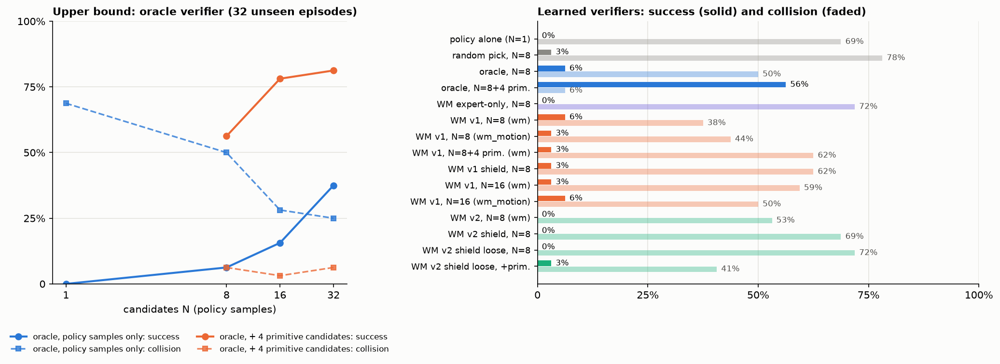

# Dreamer 世界模型 × VLA：第一轮实验结果

日期：2026-11-09　|　分支 `wm-verifier`　|　计划见 [wm_verifier_plan.md](wm_verifier_plan.md)，v0 背景见 [report.md](report.md)

一句话：**VLA 一次提出 N 个动作块，由一个裁判挑一个执行。** 用仿真的"上帝视角"当裁判，可以把闭环成功率从 0% 提到 78%（N=16 + 4 个手工候选）；用学出来的 DreamerV3 世界模型当裁判，第一版就把碰撞率从 69% 降到 38%，成功率追平 oracle N=8（6%），但离上限还很远。差距主要在"进度"判断上：世界模型不知道目标在哪。

---

## 1. 做了什么

| 部件 | 内容 | 代码 |
|---|---|---|
| 候选采样 | VLA 用 N 份固定噪声一次采 N 个动作块（共用一次 VLM 前向）；可选再加 4 个手工候选：悬停、原地左转 / 右转（0.8 rad/s）、慢速前进（0.3 m/s） | `model/vla.py: sample(n_samples)`, `wm/labels.py: primitive_chunks` |
| oracle 裁判 | 特权信息打分：沿候选飞 1.2 s 后到终点的最短路程减少量 − 碰撞惩罚 − 低离障距离惩罚；stop 候选只有在真的到达（≤1 m 且看到目标）时得正分 | `eval/closed_loop.py: score_candidates` |
| 世界模型 | DreamerV3 RSSM（复用 Sakana_WAM 的 `dv3`），**一步 = 0.5 s = 一次决策**：输入 64×64 RGB-D + 5 维状态 + 25 维动作（5 步增量），预测头：进度、不碰撞、最小离障距离、目标可见、已到达。size50m，53M 参数 | `wm/model.py`, `wm/train_wm.py` |
| 训练数据 | 专家数据集导出 1,723 条 / 52k 步；VLA 自己闭环飞出来的数据（含撞墙）：v1 用 288 条 / 5.8k 步，v2 用 544 条 | `wm/export_replay.py`, `closed_loop --dump-wm` |
| 学出来的裁判 | policy server 同时加载世界模型，对每条 episode 维护 RSSM 后验，每个候选在潜空间里想象 2 步（1.0 s），分数 = 进度 − 10·P(撞) − 5·max(0, 0.22 − 离障距离) + 0.5·目标可见 | `wm/verifier.py`, `eval/policy_server.py --wm` |
| 选择规则 | `wm`：动作按分数选，stop 只有在策略自己提出且模型同意时才执行；`wm_motion`：stop 完全听策略；`wm_shield`：默认用策略的选择，只在模型预测会撞时换成最安全的候选 | `eval/closed_loop.py --select` |
| 裁判质量 | 闭环里每次决策同时算 oracle 分数，记录学出来的裁判和 oracle 的 top-1 一致率和 regret（oracle 分差，米） | 同上 |
| 离线检验 | 在未见房子的 VLA 飞行数据上做一步预测：碰撞 AUC、离障距离、进度相关性、到达 AUC | `wm/eval_wm.py` |

---

## 2. 闭环结果（32 条未见房子的 episode，40 s 上限，和 v0 相同）

成功 = 主动停下、离终点 ≤ 1 m、目标在画面中、无碰撞。"近" = 离目标包围盒 ≤ 1.5 m。

### 2.1 上限：oracle 裁判

| 候选 | 选择 | SR | 到过目标附近 | 结束时在目标附近 | 碰撞 | 超时 | 终点误差 |
|---|---|---|---|---|---|---|---|
| N=1 | 策略自己（基线） | 0.00 | 0.25 | 0.12 | 0.69 | 0.00 | 4.07 m |
| N=8 | 随机挑 | 0.03 | 0.31 | 0.19 | 0.78 | 0.00 | 4.02 m |
| N=8 | oracle | 0.06 | 0.28 | 0.22 | 0.50 | 0.06 | 3.08 m |
| N=8 | oracle，stop 听策略 | 0.09 | 0.25 | 0.22 | 0.50 | 0.03 | 3.15 m |
| N=16 | oracle | 0.16 | 0.50 | 0.38 | 0.28 | 0.03 | 2.26 m |
| N=32 | oracle | 0.38 | 0.75 | 0.56 | 0.25 | 0.03 | 1.48 m |
| **N=8 + 4 手工** | oracle | **0.56** | 0.62 | 0.59 | **0.06** | 0.38 | 1.25 m |
| **N=16 + 4 手工** | oracle | **0.78** | 0.72 | 0.66 | **0.03** | 0.19 | 0.54 m |
| **N=32 + 4 手工** | oracle | **0.81** | 0.78 | 0.75 | 0.06 | 0.12 | 0.46 m |

怎么读：

- 只用策略自己的样本，上限随 N 明显上升：N = 1 / 8 / 16 / 32 → SR 0% / 6% / 16% / 38%，到过目标附近 25% → 75%。这就是"测试时扩展"曲线：同一个 VLA，多采样 + 好裁判，性能持续提高。
- 加 4 个手工候选后上限跳到 56–78%，碰撞几乎消失。在训练房子上的同类运行里，手工候选只在 **31%** 的决策中被选中，但 oracle **849 次**否决了策略提出的 stop（128 条 episode）。也就是说，策略最大的问题是**过早 stop**和**偶尔撞墙**，而不是完全不会飞；只要有人在旁边说"别停、别撞"，它大部分时候能到。
- 剩下的失败主要是超时（19–38%）：否决 stop 以后无人机一直在飞，40 s 内没能停在正确的位置。

### 2.2 学出来的裁判

| 世界模型 | 候选 | 选择规则 | SR | 到过目标附近 | 碰撞 | 停下 | 裁判 top-1 一致率 | regret |
|---|---|---|---|---|---|---|---|---|
| 只用专家数据 | N=8 | wm | 0.00 | 0.06 | 0.72 | 0.28 | 0.48 | 0.54 m |
| 只用专家数据 | N=8 | wm_motion | 0.00 | 0.25 | 0.59 | 0.41 | 0.45 | 0.44 m |
| 只用专家数据 | N=8+4 | wm | 0.03 | 0.16 | 0.81 | 0.16 | 0.19 | 1.76 m |
| **v1（+VLA 数据）** | **N=8** | **wm** | **0.06** | **0.31** | **0.38** | 0.62 | 0.49 | **0.19 m** |
| v1 | N=8 | wm_motion | 0.03 | 0.22 | 0.44 | 0.56 | 0.49 | 0.39 m |
| v1 | N=8+4 | wm | 0.03 | 0.31 | 0.62 | 0.28 | 0.29 | 0.96 m |
| v1 | N=8+4 | wm_motion | 0.03 | 0.25 | 0.44 | 0.56 | 0.23 | 1.09 m |
| v1 | N=8 | wm_shield（严格阈值） | 0.03 | 0.22 | 0.62 | 0.38 | 0.52 | 0.39 m |
| v1 | N=8+4 | wm_shield（严格阈值） | 0.03 | 0.22 | 0.53 | 0.41 | 0.37 | 1.02 m |
| v2（数据翻倍） | N=8 | wm | 0.00 | 0.22 | 0.53 | 0.44 | 0.46 | 0.45 m |
| v2 | N=8 | wm_shield（严格阈值） | 0.00 | 0.19 | 0.69 | 0.31 | 0.53 | 0.32 m |
| v2 | N=8+4 | wm_shield（严格阈值） | 0.00 | 0.19 | 0.66 | 0.34 | 0.37 | 0.98 m |
| v2 | N=8 | wm_shield（宽松阈值） | 0.00 | 0.22 | 0.72 | 0.25 | 0.53 | 0.41 m |
| v2 | N=8+4 | wm_shield（宽松阈值） | 0.03 | 0.28 | **0.41** | 0.53 | 0.37 | 0.70 m |
| v1 | N=16 | wm | 0.03 | 0.22 | 0.59 | 0.41 | 0.38 | 0.48 m |
| v1 | N=16 | wm_motion | 0.06 | 0.25 | 0.50 | 0.50 | 0.35 | 0.40 m |

怎么读：

- **只见过专家数据的世界模型是个坏裁判**：它没见过碰撞，把"动得快"都当成进度，挑出来的动作平均 3 秒就撞墙，比随机还差。
- **加入 VLA 自己飞的数据后（v1），裁判立刻有用**：碰撞 69% → 38%，比 oracle N=8 的 50% 还低；regret 从 0.54 m 降到 0.19 m。SR 6% 和 oracle N=8 持平。
- **但 v1 加手工候选反而变差**。原因在 2.3：它能判断"会不会撞"，判断不了"哪个方向离目标更近"。手工候选（左转 / 右转 / 前进）之间的区别恰恰全在进度上。
- **严格阈值的 shield 几乎不触发**（P(不撞) < 0.7 或离障 < 0.2 m 才换动作，只改了 3% 的决策），所以效果接近基线，只是碰撞略降（69% → 53–62%）。宽松阈值的结果见 2.4。

### 2.3 离线：世界模型到底学会了什么

在未见房子里 VLA 自己飞的 32 条 / 556 步数据上，用当前后验想象一步，和真实结果比：

| | 只用专家数据 | v1 |
|---|---|---|
| 碰撞预测 AUC | 0.50（瞎猜） | **0.95** |
| 低离障距离（< 0.2 m）AUC | 0.75 | 0.87 |
| 进度预测相关性 | 0.07 | 0.15 |
| 目标可见准确率 | 0.66 | 0.78 |
| 已到达 AUC | 0.99 | 0.99 |

- 碰撞和"已到达"学得很好，离障距离一般，**进度几乎学不到**。进度 = 到目标的最短路程减少量，而世界模型的输入里没有目标信息（没有指令、没有目标位置），在新房子里它只能猜"往开阔处飞大概是进步"。这是计划里的阶段 B 问题（目标条件价值）。
- 这也解释了 2.2：世界模型的贡献全部来自避障，所以 `wm_shield`（只做安全过滤）应该是当前最合理的用法。

### 2.4 几个补充观察



- **学出来的裁判不随 N 变好。** oracle 从 N=8 到 N=16 成功率 6% → 16%，v1 却是 6% → 3%（碰撞 38% → 59%）。候选越多，排序质量不够的裁判越容易挑到一个看起来好、实际上撞墙的候选——这正是 Test-time scaling for World Action Models 那篇文章警告过的"N 大了反而变差"。裁判的 top-1 一致率只有 38–49%，还不足以从 16 个里挑。
- **数据翻倍（v2）没有带来提升**：N=8 时 SR 0%、碰撞 53%，regret 0.45 m，比 v1 差。离线指标也只是持平（碰撞 AUC 0.92 对 0.95）。新加的数据里一半是 oracle + 手工候选飞出来的"好轨迹"，碰撞样本比例反而下降了。32 条评测的噪声是 ±1–2 条（见第 5 节），所以 v1 和 v2 的差别不能看得太重。
- **shield 需要安全的备选项才有用**：没有手工候选时，预测到危险也只能换成另一个策略样本，碰撞率不变（72%）；加上悬停 / 转向这些备选项，碰撞率降到 41%。但 shield 只改了 8–10% 的决策，成功率没有变化。
- **到目前为止最好的学出来的配置**仍是 v1、N=8、`wm`：SR 6%，碰撞 38%，regret 0.19 m。

---

## 3. 结论

1. **"策略提案 + 裁判选择"这条路是通的，而且上限很高。** 用 oracle 当裁判、N=32 加 4 个手工候选，同一个 VLA 的成功率从 0% 到 81%；只用策略自己的样本，N=32 也有 38%。这说明 v0 的 VLA 其实"会飞"，缺的是"别停、别撞、往哪转"三个判断。
2. **学出来的世界模型已经能做其中一个判断：别撞。** 一步碰撞预测 AUC 0.95，闭环碰撞率 69% → 38%（v1，N=8）。这是 Dreamer 和 VLA 结合后的第一个实际收益。
3. **它还做不了"往哪转"，所以成功率没有跟上。** 进度预测和真实进度的相关性只有 0.15：没有目标信息就没有进度。结果是：加手工候选、增大 N 都让 oracle 变好，却让学出来的裁判变差（N=16 时 SR 3%、碰撞 59%）——候选越多，排序不准的裁判越容易选错。这是下一步必须解决的，也正是计划里"阶段 B：目标条件价值"的内容。
4. **"别停"目前靠规则。** 让世界模型否决 stop 的效果有限（v1 只否决了 2 次），因为它的"已到达"头是在专家数据上学的，而策略乱停的地方它也没见过几次。
5. **只加数据不够。** v2 的数据是 v1 的两倍，但闭环没有变好。下一步的收益在"给世界模型目标信息"和"直接向 oracle 学打分"，不在更多同类数据。

---

## 4. 下一步（按优先级）

1. **目标条件的进度头（阶段 B）**：把 VLA 的 prefix 特征（指令 + 图像）作为世界模型进度头的条件输入；或者更直接地，把目标框预测（v1_plan P3.2）接进来。验证指标就是 2.3 里的进度相关性，目标 > 0.5。
2. **直接向 oracle 学打分（蒸馏）**：闭环采集时把 oracle 对每个候选的分数一起存下来（现在只存了执行的那个），训练一个"候选打分"头去模仿 oracle 的排序。这是最便宜的办法：把特权信息蒸馏到只看图像、指令和状态的模型里，并且训练目标就是闭环里真正用到的"排序"，而不是逐步的动力学预测。衡量标准直接用 top-1 一致率（现在 0.38–0.49，oracle 的排序本身就是 1.0）。
3. **更多 on-policy 数据**：v1 只有 288 条。闭环采集每 128 条约 7 分钟，一晚上可以到几千条。
4. **stop 规则**：策略过早 stop 是最大的单一问题。短期用规则（例如"已到达"头 > 0.8 才允许停），长期要回到 v1_plan 的 P1（进度状态 / 历史帧）和 P2.3（独立 stop 头）。
5. **Dreamer 式微调**（阶段 C）：等 1–2 做完、裁判和 oracle 的 top-1 一致率超过 70% 之后再做。

---

## 5. 工程记录

- **hyperlux JIT 卡死**：每个进程启动时会 `cmake --build` 检查一次，在这个集群上会随机挂死（cmake 子进程变僵尸，父进程等不到）。同时启动多个仿真还会在 NFS 上的 flock 互相死锁。解决：评测脚本设 `HYPERLUX_SKIP_BUILD=1`（跳过检查，前提是已经编译过），并用 `scripts/run_sim.sh` 串行化启动。此前所有闭环运行都是 4–6 分钟一轮，现在 1–3 分钟。
- **N=1 的结果不是逐位可复现的**：bf16 下 batch 组成不同会导致微小差异，40 s 的 rollout 把它放大成 ±2 条 episode 的差别。32 条的评测集上，SR 差 1 条就是 3%。
- 数据：`data/wm/expert`（专家，1,723 条）、`data/wm/onpolicy_v0`（VLA N=1，128 条）、`onpolicy_v0_rand`（随机 N=4，128 条）、`onpolicy_v0_orc`（oracle + 手工候选，128 条）、`onpolicy_v0_randp`（随机 + 手工候选，128 条）、`onpolicy_v0_unseen`（未见房子，32 条，只用于验证）。
- 模型：`runs/wm_expert`、`runs/wm_v1`、`runs/wm_v2`（各约 10 分钟，1×H100）。

## 6. 复现

```bash
# 专家数据 -> 世界模型 replay（CPU）
PYTHONPATH=. python -m sakana_vla.wm.export_replay --cache data/cache/v1 --out data/wm/expert
# oracle best-of-N 和手工候选（GPU job 内）
bash scripts/run_sim.sh <jobid> bon_n16p_oracle logs/x.log --split val_unseen --limit 32 --max-seconds 40 --candidates 16 --select oracle --primitives
# 采 VLA 自己的飞行数据
bash scripts/run_sim.sh <jobid> dump_a logs/d.log --split train --limit 128 --max-seconds 30 --dump-wm data/wm/onpolicy_v0
# 训练世界模型（env sakana_vla2）
PYTHONNOUSERSITE=1 python -m sakana_vla.wm.train_wm --data data/wm/expert data/wm/onpolicy_v0 data/wm/onpolicy_v0_rand data/wm/onpolicy_v0_unseen --out runs/wm_v1 --steps 8000 --repeat-onpolicy 4
PYTHONNOUSERSITE=1 python -m sakana_vla.wm.eval_wm --ckpt runs/wm_v1/best.pt --data data/wm/onpolicy_v0_unseen
# 用世界模型当裁判
bash scripts/run_sim.sh <jobid> bon_n8_wm1 logs/w.log --split val_unseen --limit 32 --max-seconds 40 --candidates 8 --select wm "--server-args=--wm runs/wm_v1/best.pt"
python scripts/bestofn_table.py runs/v1_stageA bon_
```
